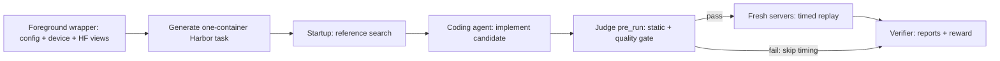

# Benchmark specification

## Purpose and status

The benchmark asks a coding agent to implement a serving system for a selected
model, workload, and machine. A tuned baseline supplies the reference. Quality
must pass before performance is measured. Coding-agent and harness token usage
is accounted for separately from the tokens generated by the serving system.

Phase 1 implements the independent foundations. The lifecycle in this document
is the agreed design; setup, servers, replay, judging, and Harbor orchestration
are implemented in their later review phases.

## Workloads

| Workload | Data pool | Planned scheduling | Output policy |
| --- | --- | --- | --- |
| `S-1` | S | One single-turn row at a time | S allowance; early stopping allowed |
| `S-N` | S | All selected single-turn rows concurrently | Same as S-1 |
| `A-1` | A | One recorded session at a time; tool delays skipped | Exactly the recorded output count |
| `A-N` | A | Eight sessions in flight; recorded tool delays preserved | Exactly the recorded output count |
| `A-MA` | A-MA | One session at a time; graph branches can overlap; tool delays preserved | Exactly the recorded output count |

The request-policy table supplies the model's thinking mode, sampling,
streaming, output-limit field, and engine-specific forced-length controls.
Agents may tune any serving-system controls. The evaluator constructs comparison
requests from this shared policy; no tuning allowlist is imposed.
Serving checkpoint acquisition uses its model string; no model revision is pinned.
Baseline source-code refs remain explicit in the engine catalog.

## Execution order

Harbor starts and owns the task sandbox. The selected
`images/<category>/Dockerfile` invokes its supplied category baseline install
scripts. They clone the catalog source refs and install engines into separate
virtual environments or native prefixes inside that container. Startup signals
readiness after reference search finishes.
The wrapper then delegates the coding-agent/verifier lifecycle to Harbor.

### Quality gate

For every workload, `judge.pre_run` will use the same fixed 24 private,
non-calibration S rows for the selected model. Reference and candidate receive
the same questions and authored policy. Submit the subset as an offline
evaluation workload and let the serving backend schedule/batch it. There is no
harness batch size or quality-request concurrency cap. The judge uses
`evaluation.method` and `evaluation.answer` to grade them.
Static checks, controlled installation, and quality all belong to this gate.
Failure skips the timed benchmark. Successful timing starts fresh servers and
excludes gate evidence from metrics.

### Replay

Replay uses each request's original `messages` and `tools`. Earlier answers in
those messages remain the recorded answers; a new response is never inserted
into a later prompt. Parents must finish before their dependent request runs.
The `tool` field specifies the post-parent delay, preserved where the workload
requires it. HTTP clients validate streams and server-reported output counts.
Replay does not grade answers or rerun the source task's original harness.

## Trusted dataset contract

The owner supplies a valid Hugging Face dataset when Phase 3 needs real rows.
The HF repository, config/pool, and public/private split are acquisition context,
not additional required columns. Setup uses `load_dataset` directly in Phase 2;
there is no Store or dataset abstraction and no dataset-quality audit.

Nested fields below denote structures; they do not require literal dotted
column names. Original JSON-encoded `messages` and `tools` are decoded at the
acquisition boundary without rewriting their content.

| Column or field | Meaning | Consumer and first phase |
| --- | --- | --- |
| `id` | Row identity | Setup selection (2); replay/report evidence (3) |
| `model` | Canonical model-table key | Setup (2) |
| `calibration` | Calibration membership | Setup view selection (2) |
| `requests[].id` | Request identity within the row | Replay (3) |
| `requests[].parents` | Parent request IDs; fork/join dependency graph | Replay (3) |
| `requests[].tool` | Delay in seconds after parents finish | Replay (3) |
| `requests[].out` | S output allowance or agentic exact output count | Policy/client/replay (3) |
| `requests[].messages` | Original conversation | Client (3) |
| `requests[].tools` | Original tool definitions | Client (3) |
| `evaluation.method` | Authored S grading method | Judge pre_run (4) |
| `evaluation.answer` | Authored S gold answer | Judge pre_run (4) |
| `source`, `item`, `harness` | Source-task and harness provenance, including harness name/version | Search (5), recording (R1) |
| `extra`, `canary` | Producer metadata and publication marker | Recording export (R1) |

Setup prepares public, calibration, and timed-private views according to
published membership. Calibration may remain in timed-private pools where the
published membership requires it. The quality subset always comes from private
non-calibration S rows, including for A-only and A-MA-only selections.

## Timing definitions

Each timed request supplies seconds from one monotonic clock:

| Field | Event |
| --- | --- |
| `t_send` | Request starts |
| `t_first` | First generated content, reasoning, or tool-call delta arrives |
| `t_last` | Final generation/finish boundary, including silent forced tokens |
| `t_end` | Response finishes, including final usage |
| `output_tokens` | Final server-reported generated-token count |
| `cached_tokens` | Server-reported cached-input tokens, or unknown |
| `ok` | Stream/request checks succeeded |

Intervals that overlap are counted once:

* **TTFT mean:** mean of `t_first - t_send` across timed requests.
* **Generation throughput:** total output tokens divided by the union of
  `[t_first, t_last]` intervals.
* **Busy throughput:** total output tokens divided by the union of
  `[t_send, t_end]` intervals, including prefill and final usage.

Reference search uses busy throughput so delaying delivery cannot increase its
selection score. Final verification compares generation throughput and TTFT
separately; Phase 1 does not implement a reward formula. Startup, warmup,
quality probes, and recorded idle tool time are outside timed request inputs.
Invalid or failed evidence must never yield a successful partial-run score.

For example, output counts 10 and 20 with decode intervals `[1,4]` and `[3,5]`
produce a four-second union and 7.5 tokens/s. Busy intervals `[0,6]` and `[2,7]`
produce a seven-second union and `30/7` tokens/s. Both TTFTs are one second.
These are arithmetic fixtures, not measured performance claims.

## Implementation costs

`eval/costs.py` consumes finalized Harbor agent results and optional trajectory
usage. It tracks input, cached-input, and output tokens plus reported, explicitly
estimated, or unknown USD cost. Cached tokens are a subset of input: input 100,
cache 40, output 10 means 110 total tokens, not 150.

Distinct attempts remain distinct, including failed attempts and retries.
Repeated collection of the same immutable attempt is idempotent. A persisted
ledger retains usage even if a trial directory is removed during later resume.
Reference-search and judge overhead have separate roles. Tokens generated by
the model being benchmarked never become coding-agent implementation costs.
