# Benchmark specification

## Purpose and status

The benchmark asks a coding agent to implement a serving system for a selected
model, workload, and machine. A tuned baseline supplies the reference. Quality
must pass before performance is measured. Coding-agent and harness token usage
is accounted for separately from the tokens generated by the serving system.

Phases 1–2 implement foundations, host setup, task rendering, and foreground
Harbor delegation. Phase 3 implements server ownership, streaming HTTP, recorded
replay and measurement. The full lifecycle is the agreed design; judging is
Phase 4 work, and adapter coordination/reference search is Phase 5 work.

## Workloads

| Workload | Data pool | Implemented scheduling | Output policy |
| --- | --- | --- | --- |
| `S-1` | S | One single-turn row at a time | S allowance; early stopping allowed |
| `S-N` | S | All selected single-turn rows concurrently | Same as S-1 |
| `A-1` | A | One recorded session at a time; tool delays skipped | Exactly the recorded output count |
| `A-N` | A | At most eight sessions in flight; recorded tool delays preserved | Exactly the recorded output count |
| `A-MA` | A-MA | One session at a time; graph branches can overlap; tool delays preserved | Exactly the recorded output count |

The request-policy table supplies the model's thinking mode, sampling,
streaming, output-limit field, and engine-specific forced-length controls. The
candidate and engines present in `request_fields.json` use the authored OpenAI
chat endpoint policy. LM Studio mappings are future Apple Silicon entries and
have no request policy yet. There is no separate native Ollama request format.
Agents may tune any serving-system controls. The evaluator constructs comparison
requests from this shared policy; only the suite’s launch identity and authored request policy remain fixed.
Serving checkpoint acquisition uses its model string; no model revision is pinned.
Baseline source repositories and code refs belong to their supplied install scripts.
Each device/engine folder also supplies launch.sh, designed in a later phase to
implement the pure Launch contract: fixed CHECKPOINT/PORT environment, served
name `served`, localhost binding and external args/env for tuning.
`baseline_map.csv` supplies the original source checkpoint and each baseline
checkpoint; it does not duplicate installer or launch configuration.

## Execution order

```mermaid
flowchart LR
    host[Foreground wrapper: config + device + HF views]
    task[Generate one-container Harbor task]
    ready[Sandbox ready]
    search[Harbor search adapter: find reference]
    handoff[Root search gate: retain reference]
    agent[Coding agent: implement candidate]
    gate[Judge pre_run: static + quality gate]
    bench[Fresh servers: timed replay]
    result[Verifier: reports + reward]
    host --> task --> ready --> search --> handoff --> agent --> gate
    gate -->|pass| bench --> result
    gate -->|fail: skip timing| result
```

Harbor starts and owns the task sandbox. The selected
`images/<category>/Dockerfile` invokes its supplied category baseline install
scripts. Each script clones its own repository/ref and installs its engine into separate
virtual environments or native prefixes inside that container. Startup only
signals environment readiness. The task declares a search step followed by a
coding step, with root verification after each and final-step rewards.
The wrapper delegates to one planned standard Harbor coordinator; Phase 5
implements its child adapter setup/run/logs/context collection and reference
finalization. Host/external search loops reach sandbox tools through Harbor;
installed search CLIs act in the same sandbox as the serving and evaluation code. The
agent receives the original checkpoint read-only at `/models/source` and the
mapped baseline model identifiers in `run.md`. A baseline matching the source
reuses that mount; distinct checkpoints are loaded or acquired by the runtime
engine inside the sandbox, using writable role storage. Engine software belongs
to the supplied `install.sh`; model weights are not image assets. Quantization
and other derived formats may be written under `/workspace`.

### Quality gate

For every workload, `judge.pre_run` will use the same fixed sample of up to 24
private S rows for the selected model. Reference and candidate receive
the same questions and authored policy. Submit the subset as an offline
evaluation workload and let the serving backend schedule/batch it. There is no
harness batch size or quality-request concurrency cap. The judge uses
`evaluation.method` and `evaluation.answer` to grade them.
Static checks, controlled installation, and quality all belong to this gate.
Failure skips the timed benchmark. Successful timing starts fresh servers and
excludes gate evidence from metrics.

### Replay

Replay uses each request's original `messages` and `tools`. Earlier answers in
those messages remain the recorded answers; a new response is never inserted
into a later prompt. Parents must finish before their dependent request runs.
The `tool` field specifies the post-parent delay, preserved where the workload
requires it. HTTP clients validate streams and server-reported output counts.
Replay does not grade answers or rerun the source task's original harness.

The benchmark CLI takes model, workload and script path. It infers the baseline
and category from the category-owned script directory, maps checkpoint/request
policy, loads the role's data/<pool>/rows.jsonl and filters by model. It allocates
a free localhost port and saves each invocation beneath bench/<uuid>. Optional
--params supplies tuning args/env. Source-equal mappings and candidate scripts
receive /models/source; distinct mappings retain their model identifiers. Launch
checks protected fields without reading a template; Server starts its argv/env.
measure() sends one separate warmup, then replays all selected rows. Diagnostic
attachment is available through the API. CLI runs always own their process.
An owned server is stopped with its process group on success, failure or
cancellation; attached servers are left running. Invalid warmup/stream evidence
raises `ReplayError`; HTTP/JSON/transport errors propagate. Replay task groups
cancel unfinished sibling requests. A failed replay returns no partial report.
Each streaming request has a total deadline, including streams that keep sending
heartbeats without completing.

Recording preserves the exact upstream request after protocol conversion, its
structured streamed response, genuine output counts, and causal/timing evidence.
It has no local tokenizer, prompt-rendering, token-ID decoding, or token-ID
verification requirement. Serving engines handle their own model tokenization.

## Trusted dataset contract

The owner supplied valid public/private S, A and A-MA recordings in
`edge-harness-v2/local_eval_data/` for Phase 3. Development tests use its public
rows; production setup accepts the configured Hugging Face dataset source.
The HF repository, config/pool, and public/private split are acquisition context,
not additional required columns. Setup uses `load_dataset` directly in Phase 2;
there is no Store or dataset abstraction and no dataset-quality audit.

Nested fields below denote prepared structures; they do not require literal
dotted column names. Setup writes supplied row values unchanged. It does not
decode, normalize or validate dataset fields.

| Column or field | Meaning | Consumer and first phase |
| --- | --- | --- |
| `id` | Row identity | Setup selection (2); replay/report evidence (3) |
| `model` | Canonical model-table key | Setup (2) |
| `requests[].id` | Request identity within the row | Replay (3) |
| `requests[].parents` | Parent request IDs; fork/join dependency graph | Replay (3) |
| `requests[].tool` | Delay in seconds after parents finish | Replay (3) |
| `requests[].out` | S output allowance or agentic exact output count | Policy/client/replay (3) |
| `requests[].messages` | JSON string containing the original conversation | Client (3) |
| `requests[].tools` | Nullable JSON string containing the original tool definitions | Client (3) |
| `evaluation.method` | Authored S grading method | Judge pre_run (4) |
| `evaluation.answer` | Authored S gold answer | Judge pre_run (4) |
| `source`, `item`, `harness` | Source-task and harness provenance, including harness name/version | Search (5), recording (R1) |
| `extra`, `canary` | Producer metadata and publication marker | Recording export (R1) |

Setup serializes selected prepared HF rows directly into `rows.jsonl`, preserving
all supplied values. Public and timed-private memberships stay unchanged.
The client parses only the known `messages` and `tools` JSON fields when building
an HTTP body. Setup and replay do not normalize the dataset. `evaluation`,
`harness` and `extra` are also encoded JSON fields in the supplied rows; their
own later consumers parse them when needed.
Calibration is a seeded random sample of up to 24 private S rows per model,
shared across every workload. No `calibration` column is required. Quality uses
an independent seeded sample of up to 24 private S rows and may overlap with
calibration. A-only and A-MA-only runs also load S-private for both samples;
they do not load S-public. Search and coding use separate identities and role
contexts; the coding handoff contains reference settings and measurements,
not private questions or answers.

## Timing definitions

Each timed request supplies seconds from one monotonic clock:

| Field | Event |
| --- | --- |
| `t_send` | Request starts |
| `t_first` | First generated content, reasoning, or tool-call delta arrives |
| `t_last` | Final generation/finish boundary, including silent forced tokens |
| `t_end` | Response finishes, including final usage |
| `output_tokens` | Final server-reported generated-token count |
| `cached_tokens` | Server-reported cached-input tokens, or unknown |
| `ok` | Stream/request checks succeeded |

Intervals that overlap are counted once:

* **TTFT mean:** mean of `t_first - t_send` across timed requests.
* **Generation throughput:** total output tokens divided by the union of
  `[t_first, t_last]` intervals.
* **Busy throughput:** total output tokens divided by the union of
  `[t_send, t_end]` intervals, including prefill and final usage.

Reference search uses busy throughput so delaying delivery cannot increase its
selection score. Final verification compares generation throughput and TTFT
separately; Phase 1 does not implement a reward formula. Startup, warmup,
quality probes, and recorded idle tool time are outside timed request inputs.
Invalid or failed evidence must never yield a successful partial-run score.
The stream must contain a generated delta, a finish marker, final completion
usage and `[DONE]`. Agentic completion usage must equal the recorded `out`; S
may stop earlier. Counts come from server usage, including invisible forced
tokens. The finish marker defines the final generation boundary; a role-only
delta does not define TTFT. Phase 3 records text, reasoning and reconstructed
tool calls as evidence without grading them.

For example, output counts 10 and 20 with decode intervals `[1,4]` and `[3,5]`
produce a four-second union and 7.5 tokens/s. Busy intervals `[0,6]` and `[2,7]`
produce a seven-second union and `30/7` tokens/s. Both TTFTs are one second.
These are arithmetic fixtures, not measured performance claims.

## Implementation costs

`eval/costs.py` consumes finalized Harbor agent results and optional trajectory
usage. It tracks input, cached-input, and output tokens plus reported, explicitly
estimated, or unknown USD cost. Cached tokens are a subset of input: input 100,
cache 40, output 10 means 110 total tokens, not 150.

Distinct attempts remain distinct, including failed attempts and retries.
Repeated collection of the same immutable attempt is idempotent. A persisted
ledger retains usage even if a trial directory is removed during later resume.
Search-agent billing is not recorded: no search cost ledger, report or exported
billing trajectory. The Phase 5 coordinator must omit search usage/cost from its
delegated context, while preserving operational and calibration evidence. The
runner records only coding-step usage, skipping search-only and pre-step
cancelled trials. Tokens generated by the served model never become
coding-agent implementation costs.
