# Benchmark specification

## Purpose and status

The benchmark asks a coding agent to implement a serving system for a selected
model, workload, and machine. A tuned baseline supplies the reference. Quality
must pass before performance is measured. Coding-agent and harness token usage
is accounted for separately from the tokens generated by the serving system.

Phases 1–2 implement foundations, host setup, task rendering, and foreground
Harbor delegation. Phase 3 implements server ownership, streaming HTTP, recorded
replay and measurement. Phase 3 is committed as `efd3650`. Phase 4 implements the
fresh-container pre-run judge, timed verifier and native Harbor oracle submissions
for review, including three native jobs and trusted reference handoff. Supplied device assets and production acceptance
remain Phase 6 work.

## Workloads

| Workload | Data pool | Implemented scheduling | Output policy |
| --- | --- | --- | --- |
| `S-1` | S | One single-turn row at a time | S allowance; early stopping allowed |
| `S-N` | S | All selected single-turn rows concurrently | Same as S-1 |
| `A-1` | A | One recorded session at a time; tool delays skipped | Exactly the recorded output count |
| `A-N` | A | At most eight sessions in flight; recorded tool delays preserved | Exactly the recorded output count |
| `A-MA` | A-MA | One session at a time; graph branches can overlap; tool delays preserved | Exactly the recorded output count |

The request-policy table supplies the model's thinking mode, sampling,
streaming, output-limit field, and engine-specific forced-length controls. The
candidate and engines present in `request_fields.json` use the authored OpenAI
chat endpoint policy. There is no separate native Ollama request format.
Agents may tune any serving-system controls. The evaluator constructs comparison
requests from this shared policy; only the suite’s launch identity and authored request policy remain fixed.
Serving checkpoint acquisition uses its model string; no model revision is pinned.
Baseline source repositories and code refs belong to their supplied install scripts.
Each device/engine folder also supplies launch.sh, designed in a later phase to
implement Launch: an optional unfilled CHECKPOINT input, fixed port 8000 and
served name `served`, localhost binding and external args/env for tuning. A
complete candidate launcher owns its final weights and optimized parameters.
`baseline_map.csv` supplies the original source checkpoint and each baseline
checkpoint; it does not duplicate installer or launch configuration.

## Execution order

```mermaid
flowchart LR
    setup[Host: columns, weights, three task folders] --> search[Native search job / search.agent]
    search --> select[Root selection gate]
    select --> handoff[Reference settings + read-only selected weights]
    handoff --> coding[Native coding job / agent / fresh container]
    coding --> source[Root format gate / source-only submission]
    source --> verify[Native verification job / nop / fresh container]
    verify --> prepare[prepare / root]
    prepare --> review[review / judge / Rewardkit]
    review --> measure[measure / root / quality then timing]
    measure --> result[Final score / coding-only costs]
```

Each job starts a separate container from the same category image. The search
Compose definition builds that image with selected baseline installers; coding
and verification reuse its tag. Standard Harbor adapters own search and coding
setup, execution, model selection, authentication and native logs.

Search sees its private-S calibration rows and all mapped weights read-only.
It writes `/home/search/selection.json`: a mapped baseline and adjustable args/env,
or an actual benchmark report with a `parameters` object. The trusted root gate
checks the mapping and fixed launch inputs, then publishes reference metadata.
The wrapper copies only that metadata and selects the corresponding pre-acquired
weight directory for read-only `/models/reference`. Coding gets public task/S
rows and source/reference weights, with no search home, calibration or processes.

Coding's root verifier checks format and declares only `/workspace/submission`
for native artifact collection. The wrapper copies source into
`verification/<id>/steps/prepare/workdir/submission`. No installed dependencies,
candidate checkpoints or caches transfer. Verification remakes them from submitted
code, `install.sh`, `launch.sh` and optional `convert_weight.sh`.

The verification task uses nop with prepare/root, review/judge and measure/root.
Its steps share one fresh container, gated by native `min_reward = 1` for prepare
and review. Root converts and installs, then the image's prepare script makes the
completed artifacts readable and non-writable by judge. Judge owns a separate
writable home/cache/output. It inspects through native Rewardkit. Root retains
writes for quality and measurement, with private inputs inaccessible to judge.

Search/coding gate rewards never enter performance scoring. The wrapper records
final verification results, all three trial paths and coding-only implementation
usage. Failed gates skip dependent jobs for that logical task; infrastructure
errors remain distinct from a scored candidate failure.

### Quality gate

For every workload, `verify.run.pre_run` uses the saved sample of up to 24 private S
rows for the selected model. Reference and candidate receive the same questions
and S policy through the shared quality executor, with concurrency `-1`.
The serving backend owns batching. There is no quality warmup or timing/count
measurement, and no separate quality submission loop.

The verification task runs in this order:

1. Require submission `install.sh` and `launch.sh`; reject script links escaping
   the source directory. An optional `convert_weight.sh` must also be a valid
   submitted script.
2. Run `convert_weight.sh` when present, as root with internet and read-only
   source `CHECKPOINT=/models/source`. Its output belongs under
   `WEIGHTS=/workspace/weights`. Because conversion precedes installation, it
   supplies any prerequisites missing from the category image.
3. Run `install.sh` as root, reproducing dependencies/runtime under
   `RUNTIME=/workspace/runtime` or the submission. Conversion and
   installation each use the configured installation deadline. Their failures
   stop before review or serving.
4. Root invokes the image's trusted `images/prepare.sh` to prepare access to the
   completed submission/runtime/weights. They become root-owned and readable
   without granting judge write access; root retains write access. The judge
   gets a private writable home, cache and review output. Model/data mounts
   remain unchanged, and private evaluator inputs stay inaccessible to judge.
5. Harbor runs the review verifier as `judge`; it invokes native Rewardkit.
   Inspect implementation, conversion/installation/launch scripts, resulting
   checkpoint metadata/provenance and relevant dependencies. Review six binary
   rules together with all-pass aggregation. Private datasets are inaccessible.
6. Start a fresh root reference server at `127.0.0.1:8000`, require alias `served`,
   replay the complete S sample in quality mode, and stop it. Repeat for a fresh
   root candidate. A wrong-port candidate fails before sending requests.
7. Compare every selected row using the exact paired quality test as root.

Each trusted row's encoded `evaluation` supplies `method` and `answer`.
`eval.accuracy.grade()` resolves `letter` or `math_verify` to a dedicated Python
checker after removing text before the final `</think>`. The mathematical checker
uses Math-Verify, anchored/boxed extraction, and gold-to-prediction comparison.
The letter checker extracts a final explicit A–D or supported bare-letter answer.
Neither the judge nor timing metrics implement answer parsing.

Quality requires an actual complete response and valid stream, but no TTFT or
output-token usage. Internal results keep per-row correctness for the gate;
public quality CLI reports only final accuracy. Missing answers cannot be dropped
from the paired comparison.

The one-sided exact McNemar test counts reference-only correct answers as
`lost`, candidate-only correct answers as `won`, and uses the binomial tail from
`lost` through `lost + won`. Pass requires probability at least `0.05` and
complete coverage of selected IDs. Identical grades pass with probability 1.
The test fixture has 20 pairs: five losses and no wins gives `1/32` and fails;
four losses and no wins gives `1/16` and passes. Passing means no significant
measured degradation, not necessarily identical accuracy.

Prepare and review each require reward 1; native Harbor stops the task when a
gate fails. Within measure, quality failure skips timing; a pass starts fresh
reference then candidate servers with separate warmups. Native step TOML selects
root for preparation and measurement and judge for the entire review verifier.
Harbor supplies the identities without a local user-switching launcher. Conversion, installation and review are online. Quality/timed
serving runs as root under IPv4/IPv6 loopback-only rules. Cleanup stops owned
process groups before restoring egress; it never terminates all root processes.

`judge.py` defines submission checks, the native review inputs/results and paired
quality decisions. It has no access control or process/network management.
`verify/run.py` owns procedure order, execution, deadlines, gates and cleanup;
the image defines reviewer users, writable paths and artifact permissions.

### Submission rules

The Rewardkit agent judge reads source, `install.sh`, `launch.sh`, optional
`convert_weight.sh` and declared upstream provenance. It inspects the generated
checkpoint and the code that creates and uses it; relevant installed dependencies
are available for inspection. Private data and measurement outputs remain excluded.
No source/binary size cap or serving-tuning allowlist is imposed.

| Rule | Required behaviour |
| --- | --- |
| Generated answers | Generate answers from the selected model; prompt KV caching is allowed. |
| Consistent behaviour | Do not detect benchmark inputs, IDs or warmup to change behaviour. |
| Selected model | Use the supplied source or a documented derived representation; quantization and serving optimization are allowed. |
| Authored requests | Preserve messages/tools, chat template, thinking, sampling and workload output policy. |
| Honest streams | Stream actual generation and report genuine completion counts without padding or fabricated timing. |
| Independent serving | Serve locally without outside services or interference; controlled work must not outlive installation/server processes. |

`evaluation.agent` selects `name` (`claude-code`, `codex` or `fx`), optional `model`,
`auth`, `env`, `budget` and native Rewardkit `kwargs`. It is independent of the
search/coding adapters. Login forwards native environment inputs:
`CLAUDE_CODE_OAUTH_TOKEN`, `CODEX_AUTH_JSON` or `VERCEL_OIDC_TOKEN`. The evaluator
does not read or mount host login files, and a host CLI login alone does not
supply credentials to the verifier. API mode uses the provider-key defaults.
Explicit `env` names override defaults through the review step's
`[steps.verifier.env]`; other steps receive no reviewer credentials.
Credential values never enter task.json, image layers or saved run YAML.

Every rule must return a binary decision. A violation needs reasoning and source
evidence; an errored, missing or incomplete review is infrastructure failure,
not a rule violation. Raw Rewardkit results persist under
`/workspace/review-output`; the review step exports flat files into its native verifier log
directory so Harbor can archive them across host/container users. The measure verifier owns performance rewards, and the wrapper publishes
that final result rather than the handoff or gate rewards.

Review runs inside the fresh verifier under an independent Unix user/home, with
read access to candidate source, dependencies and weights. Root retains write
access throughout verification. The judge's separate home/cache/output remains
writable; private datasets beneath `/root/eval` are inaccessible. Verification
Compose declares `no-new-privileges:true`; root stays root, while executions
cannot elevate judge through setuid programs. The reviewer finishes and its processes stop before quality/timing and their reports exist. Rewardkit overlay
isolation is not requested. The supplied image provides the selected reviewer CLI.
[Rewardkit integration](https://docs.harborframework.com/core-concepts/rewardkit/quick-start),
[agent judges](https://docs.harborframework.com/core-concepts/rewardkit/judge-criteria).

### Replay

Replay preserves recorded messages and tools. Generated text never replaces a
later recorded answer. Every request waits for its parents, then its recorded
tool delay where the workload preserves delays.

Concurrency controls independent rows/sessions: omission uses the table's
workload default, a positive integer limits active sessions, and `-1` admits all
rows immediately. Parent dependencies and delays within a row remain respected.
Independent branches can overlap.

The shared executor has timing and quality modes. Timing sends one excluded
warmup, then validates stream/count evidence and computes metrics. Quality uses
S policy, sends no warmup, disregards timings/counts and dispatches each row's
accuracy function after replay and server cleanup. Scheduling does not grade
answers; the accuracy package does. The same replay is used by public checks and
private verification.

The CLI takes model, workload and script path. Complete launchers run unchanged;
unfilled CHECKPOINT templates resolve the selected model/workload's engine and
device mapping. Baseline paths identify that engine/category. A copied template
uses public `reference.json` in the role's working directory. The reference
finalizer publishes category/baseline/checkpoint/args/env alongside the protected
selection. No source-checkpoint fallback is imposed on complete candidates.

Every owned server listens on port 8000 and advertises `served`. Startup rejects
preexisting listeners, wrong aliases/ports, timeout and an exited foreground
process. `/bin/bash` is fixed; external tuning cannot replace model, host, port,
served name, CHECKPOINT, PORT or shell startup hooks. An optional parameters file
supplies other args/env. Scripts are not rewritten and PORT is never injected.

Timing loads the workload's `data/<pool>/rows.jsonl`; quality loads S for every
task. Reports are saved under `bench/<uuid>`. API-only diagnostic attachment
leaves its server running; owned groups stop on success, failure or cancellation.
Failed streams retain row/request context, cancel unfinished siblings and produce
no successful partial score. A total request deadline includes endless heartbeats.

The future recorder preserves upstream requests, streamed responses, genuine
counts and causal/timing evidence. It needs no local tokenizer, prompt rendering
or token-ID verification; serving engines own tokenization.

## Trusted dataset contract

The owner supplied valid public/private S, A and A-MA recordings in
`edge-harness-v2/local_eval_data/` for Phase 3. Development tests use its public
rows; production setup accepts the configured Hugging Face dataset source.
The HF repository, config/pool, and public/private split are acquisition context,
not additional required columns. Setup uses `load_dataset` directly in Phase 2;
there is no Store or dataset abstraction and no dataset-quality audit.

Nested fields below denote prepared structures; they do not require literal
dotted column names. Setup writes supplied row values unchanged. It does not
decode, normalize or validate dataset fields.

| Column or field | Meaning | Consumer and first phase |
| --- | --- | --- |
| `id` | Row identity | Setup selection (2); replay/report evidence (3) |
| `model` | Canonical model-table key | Setup (2) |
| `requests[].id` | Request identity within the row | Replay (3) |
| `requests[].parents` | Parent request IDs; fork/join dependency graph | Replay (3) |
| `requests[].tool` | Delay in seconds after parents finish | Replay (3) |
| `requests[].out` | S output allowance or agentic exact output count | Policy/client/replay (3) |
| `requests[].messages` | JSON string containing the original conversation | Client (3) |
| `requests[].tools` | Nullable JSON string containing the original tool definitions | Client (3) |
| `evaluation.method` | Named trusted Python S accuracy checker | Accuracy dispatch / quality replay (4) |
| `evaluation.answer` | Authored S gold answer | Accuracy checker (4) |
| `source`, `item`, `harness` | Source-task and harness provenance, including harness name/version | Search (5), recording (R1) |
| `extra`, `canary` | Producer metadata and publication marker | Recording export (R1) |

Setup serializes selected prepared HF rows directly into `rows.jsonl`, preserving
all supplied values. Public and timed-private memberships stay unchanged.
The client parses only the known `messages` and `tools` JSON fields when building
an HTTP body. Setup and replay do not normalize the dataset. `evaluation`,
`harness` and `extra` are also encoded JSON fields in the supplied rows; their
own later consumers parse them when needed.
Calibration is a seeded random sample of up to 24 private S rows per model,
shared across every workload. No `calibration` column is required. Quality uses
an independent seeded sample of up to 24 private S rows and may overlap with
calibration. A-only and A-MA-only runs also load S-private for both samples;
they also load S-public for public quality checks. Search and coding use separate identities and role
contexts; the coding handoff contains reference settings and measurements,
not private questions or answers.

## Timing definitions

Each timed request supplies seconds from one monotonic clock:

| Field | Event |
| --- | --- |
| `t_send` | Request starts |
| `t_first` | First generated content, reasoning, or tool-call delta arrives |
| `t_last` | Final generation/finish boundary, including silent forced tokens |
| `t_end` | Response finishes, including final usage |
| `output_tokens` | Final server-reported generated-token count |
| `cached_tokens` | Server-reported cached-input tokens, or unknown |
| `ok` | Stream/request checks succeeded |

Intervals that overlap are counted once:

* **TTFT mean:** mean of `t_first - t_send` across timed requests.
* **Generation throughput:** total output tokens divided by the union of
  `[t_first, t_last]` intervals.
* **Busy throughput:** total output tokens divided by the union of
  `[t_send, t_end]` intervals, including prefill and final usage.

Reference search uses busy throughput so delaying delivery cannot increase its
selection score. Final verification compares generation throughput and TTFT
separately. Startup, warmup,
quality probes, and recorded idle tool time are outside timed request inputs.
Invalid or failed evidence must never yield a successful partial-run score.
The stream must contain a generated delta, a finish marker, final completion
usage and `[DONE]`. Agentic completion usage must equal the recorded `out`; S
may stop earlier. Counts come from server usage, including invisible forced
tokens. The finish marker defines the final generation boundary; a role-only
delta does not define TTFT. Phase 3 records text, reasoning and reconstructed
tool calls as evidence without grading them.

For example, output counts 10 and 20 with decode intervals `[1,4]` and `[3,5]`
produce a four-second union and 7.5 tokens/s. Busy intervals `[0,6]` and `[2,7]`
produce a seven-second union and `30/7` tokens/s. Both TTFTs are one second.
These are arithmetic fixtures, not measured performance claims.

## Rewards and reports

The verifier measures the protected reference first, then the candidate, after
the full gate passes. Each timed run uses a fresh server context and the shared
measurement API, including one separate warmup.

| Reward | Speed ratio `G` |
| --- | --- |
| Throughput | candidate throughput / reference throughput |
| TTFT | reference mean TTFT / candidate mean TTFT |

Each reward is `round(100 * max(0, 1 - 1/G), 2)`. Twice the throughput or half the
TTFT earns 50; equal or slower performance earns zero. The rewards are independent.
Candidate preparation or rule failures stop their native step with
`{"reward": 0}`; no performance step runs. Candidate startup, quality or stream
failures in `measure` earn zero for both performance rewards.
Reference failures, unusable reviewer results and environment failures produce
an infrastructure outcome with no reward file.

Each native verifier writes its step report and reward under `/logs/verifier`.
Harbor archives and resets this directory between steps. Root preparation state
persists under `/root/eval/verification`, while rubric and review output persist
under `/workspace/review-rubric` and `/workspace/review-output`. The final measure
step writes `report.json` and `report.md`; scored outcomes also write `reward.json`. It removes stale reward output before a new
attempt. Gate failures record `bench.skipped = true`; timed failures retain
their stage evidence and never score a successful partial run.

### Native Harbor oracle sanity check

`agent.name: oracle` selects Harbor's built-in OracleAgent for both search and
coding. Each native task supplies `solution/solve.sh`: search measures the first
mapped baseline on S-N calibration and saves its selection; coding writes an
ordinary baseline-backed submission. The trusted selection gate, source handoff
and fresh verification run unchanged. The oracle provides implementation code,
not precomputed answers, and never bypasses installation, review, quality or timing.

The opt-in Harbor cases reuse an existing production device image and real Claude
Code for Rewardkit review. Their explicit search solution selects metadata without
inference, because checkpoint shards/engine runtime are not available. They prove
native agents, separate containers, handoffs and reviewer permissions; full
production inference/quality/timing remains a separate acceptance requirement.

## Implementation costs

`eval/costs.py` consumes finalized Harbor agent results and optional trajectory
usage. It tracks input, cached-input, and output tokens plus reported, explicitly
estimated, or unknown USD cost. Cached tokens are a subset of input: input 100,
cache 40, output 10 means 110 total tokens, not 150.

Distinct attempts remain distinct, including failed attempts and retries.
Repeated collection of the same immutable attempt is idempotent. A persisted
ledger retains usage even if a trial directory is removed during later resume.
Search-agent billing is not added to our costs ledger. Native Harbor retains its
own ordinary job evidence; the wrapper collects only coding trial results and
trajectories. Failed/interrupted coding attempts and retries remain accounted for.
Serving tokens and reviewer usage never become coding implementation costs.
