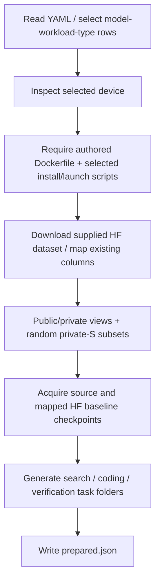
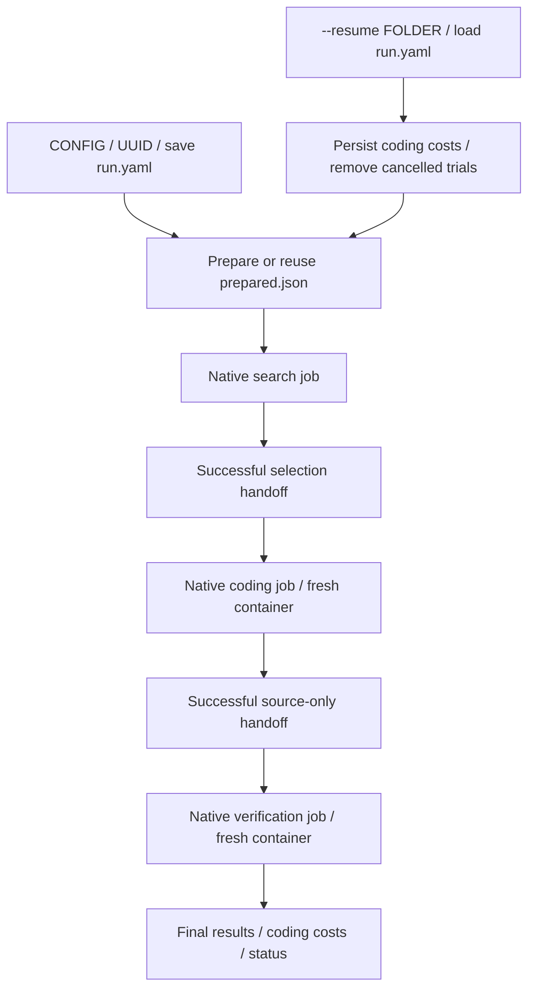

# Phase 2 review packet

## Status

Phase 2's setup/config foundations are committed. The task and runner interfaces
below include the current Phase 4 three-job redesign, which remains uncommitted.
The supplied dataset is trusted: setup maps columns without an audit or tokenizer.

## Review order

1. `eval/models.py`: ordinary HF CLI checkpoint acquisition; native tags remain IDs.
2. `eval/setup.py`: public/private views, independent random private-S calibration
   and quality samples, source/baseline assets and preparation marker.
3. `eval/tasks.py` and `templates/`: native task generation, users, read-only inputs
   and source/selection artifact declarations.
4. `eval/run.py`: three native jobs, handoffs, folder-only resume, results and costs.
5. `tests/test_setup.py`, `tests/test_tasks.py`, `tests/test_run.py`: acquisition,
   generated contracts and lifecycle tests, two common and two edge cases per area.

## Setup flow



Setup never builds an image or runs installers. Harbor builds the supplied device
Dockerfile for search; the Dockerfile installs selected baselines in separate
venvs/native prefixes. Coding and verification reuse that image tag in fresh
containers. Source-equal mappings reuse source files; distinct HF packages are
acquired into `models/<model>/baselines/<engine>` and mounted read-only. Native
engine tags remain identifiers. Fresh offline verification cannot pull an uncached
tag; the supplied launcher must resolve it from available assets. No native cache transfers.

Calibration is a simple seeded sample of up to 24 private S rows, shared across
all workloads of a model. Quality is an independent sample using seed+1, also
up to 24. These views can overlap; timing retains the supplied private membership.
Prepared rows preserve authored messages, tools, parents, tool delays, counts and
checker metadata. Only the evaluator receives private/quality views.

## Generated Harbor tasks

```text
runs/<uuid>/
  run.yaml
  prepared.json
  image.json
  input/<model>/...
  models/<model>/source/
  models/<model>/baselines/<engine>/
  search/<task-id>/
    instruction.md
    task.toml
    environment/docker-compose.yaml
    tests/test.sh
    solution/solve.sh
    reference/metadata/             root-written selected reference + gate report
  coding/<task-id>/
    instruction.md
    task.toml
    environment/{docker-compose.yaml,task.json,run.md,start.sh}
    tests/test.sh
    solution/solve.sh
    reference/metadata/{public.json,reference.json}
    reference/weights              selected host-weight symlink after search
  verification/<task-id>/
    task.toml
    environment/docker-compose.yaml
    steps/{prepare,review,measure}/{instruction.md,tests/test.sh}
    steps/prepare/workdir/submission/   source-only handoff after coding
  jobs/{search,coding,verify}/
  result.json
  costs.json
  cost-summary.json
```

Search and coding use standard single-step Harbor tasks. Native `[agent].user`
selects search or agent; the native job config chooses the corresponding adapter.
All three Compose files bind the same protected coding/environment/task.json
and readiness script; these are immutable shared inputs, not container state.
The search task builds one category image, while coding/verification Compose
only reuse that tag. Native agent env supplies role HOME/USER/LOGNAME and task
workdir supplies `/home/search` or `/workspace`.

Harbor's single-step lifecycle collects artifacts before its test verifier.
Search therefore uses a root `verifier.collect` hook to run
`eval.search.run --stage collect`: stop search servers, validate the selected
mapping/launch params and publish trusted reference metadata. Its test runs
`--stage gate` to report the protected decision. Search declares only that
reference directory as its artifact. The wrapper copies public/protected selection
and points the selected-weight mount at trusted prepared assets, not agent paths.

Coding gets public task/S rows and read-only source/reference weights. It gets no
search home, calibration, dependencies, caches or processes. Its root collection
hook stops coding leftovers and clears implicit artifact children. The ordinary
root verifier checks the submission format. The only declared artifact is
`/workspace/submission`: code, install/launch and optional conversion scripts.

Verification uses native nop and ordered prepare/root, review/judge, measure/root
steps sharing one fresh container. Its prepare workdir receives the source
artifact. Image-defined accounts, native TOML users and the root prepare script
provide reviewer permissions; judge.py only defines evaluation behaviours.

## Run and resume flow



The wrapper translates `search.agent` and `agent` directly into native Harbor
agent configs, including optional model, kwargs, credential variable names and
budgets. No local agent coordinator or nested delegate exists. Verification's
job agent is nop; `evaluation.agent` selects its Rewardkit reviewer.
`agent.name: oracle` chooses native oracle for search and coding, with each task's
ordinary `solution/solve.sh`; all gates still apply.

There is no background mode. Jobs/trials run serially on selected GPUs. Resume
loads the saved three native job configs, retains completed trials including
failures, assumes the same dataset version, and copies handoffs only once.
Checkpoint downloads use HF CLI reuse. Only coding results/trajectories enter
implementation costs, and cancellation usage is saved before trial cleanup.
Final `result.json` links all three trials and uses verification rewards only.

The following validation record is historical Phase 2 evidence. Current
three-job validation is recorded in [Phase 4](phase-04.md).

## Executed validation

```bash
uv run pytest -q
uv run ruff check .
uv run ruff format --check .
uv run python examples/inspect_foundations.py config.example.yaml
uv run hf download --help
uv build
```

The inspector reads the actual checked-in catalogs and prints the C2 source and
baseline identifiers, inferred image/installer paths, and authored request fields.
The model test executes a local CLI shim under a restrictive host umask to verify
the real subprocess arguments and readable output modes; no HF package download
occurs. Renderer tests load actual Harbor 0.23 task schemas and run Compose's
configuration parser. Setup tests use real HF `Dataset` objects with the published
columns. Runner tests replace only the Harbor job boundary and also resolve a
real no-op child class through Harbor's custom import-path factory. The saved
fixtures contain large search usage and separate coding usage; implementation
costs include only the coding step and its trajectory, and skip search-only trials.

| Area | Common case 1 | Common case 2 | Edge case 1 | Edge case 2 |
| --- | --- | --- | --- | --- |
| Baseline map | Source/baseline checkpoint pair | Engine union deduplication | Unknown category has no rows | Model/category without mappings |
| Request policy | Candidate OpenAI fields | Ollama OpenAI overrides | Stream usage and workload counts | Caller data remains unchanged |
| Models | Direct HF CLI download/readable modes | Native identifier without host download | Destination with spaces | Native CLI failure |
| Tasks | Native Harbor steps/Compose schema and role mounts | Shared image/per-task checkpoints | Missing source asset | Ready-only startup and isolated step hooks |
| Setup | Unchanged rows, random S samples, source-only download | Shared S calibration/quality for A/MA and source reuse | Missing installer before acquisition | Small S pool and interrupted preparation retry |
| Runner | UUID/config, two role configs, independent budgets | Custom-child resume and coding-only costs | Interruption/search-only/native malformed JSON | CLI combinations/removed flag |

All **40 tests** pass: ten implemented areas, four cases per area. Ruff lint and
formatting, the real inspector, shell syntax, and sdist/wheel builds pass. No
production image build, GPU benchmark, actual dataset/model acquisition, or paid
agent call is claimed. The host probe currently implements Linux NVIDIA x86;
other image categories and real engine acceptance await their supplied assets.

HF download behavior follows the [official CLI guide](https://huggingface.co/docs/huggingface_hub/guides/cli#hf-download).
Harbor uses its [task configuration](https://docs.harborframework.com/core-concepts/tasks/configuration),
[multi-step format](https://docs.harborframework.com/core-concepts/tasks/multi-step)
and [custom-agent interface](https://docs.harborframework.com/core-concepts/agents/custom-agents).
