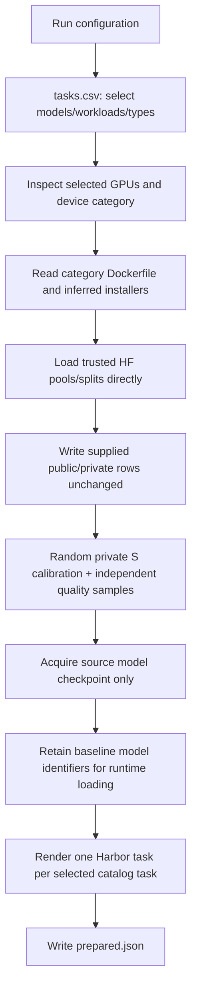
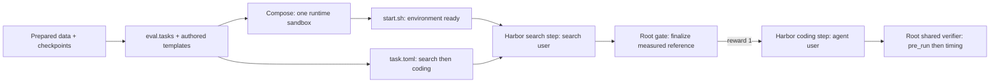
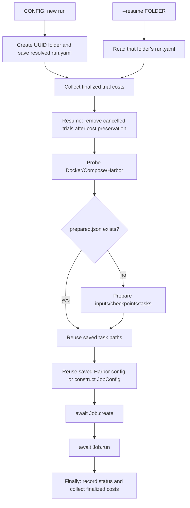

# Phase 2 review packet

## Status

Committed as `32ba1da` (`feat: prepare native Harbor evaluation tasks`).
Phase 1 remains commit `af52a39`. Production Dockerfiles and installers are
still owner-supplied. Phase 3's server/client/replay modules are now implemented
for review; the verifier arrives in Phase 4, and the adapter coordinator and
reference search arrive in Phase 5. Phase 3 extends the supplied image-asset
contract with per-baseline launch.sh beside install.sh; current setup requires
and hashes both scripts. See [the revised Phase 3 packet](phase-03.md).

Phase 2 maps configuration and trusted Hugging Face rows into Harbor tasks,
downloads their source checkpoints, and prepares/runs/resumes one foreground Harbor job.
The generated contract now declares native search then coding steps. Their future
coordinator delegates existing Harbor adapters; startup only readies the sandbox.

Phase 3 now also mounts public views at `/workspace/data/<workload-pool>` and
shared S calibration at `/home/search/data/S`. Its smaller measurement CLI loads
those prepared views by workload automatically. Metadata input key names remain
unchanged; the approved Phase 2 commit is preserved.

## Review order

| Order | Read | Purpose |
| --- | --- | --- |
| 1 | `README.md`, `images/README.md`, `pyproject.toml`, `install.sh` | Runtime-only device image, host dependency extra, settings, and fixed installer layout. |
| 2 | `tables/baseline_map.csv`, `eval/baselines.py` | Select engines and both original/source and baseline checkpoint identifiers. |
| 3 | `tables/request_fields.json`, `eval/request_policy.py` | Build the authored OpenAI requests for supported baselines and candidates. |
| 4 | `eval/models.py`, `tests/test_models.py` | Delegate ordinary checkpoint downloads to the HF CLI; native tags remain identifiers. |
| 5 | `eval/tasks.py`, `templates/`, `tests/test_tasks.py` | Generate ordered Harbor search/coding steps, role mounts/budgets, ready-only startup and isolated root hooks. |
| 6 | `eval/setup.py`, `tests/test_setup.py` | Transfer prepared rows, sample shared private S views, acquire the source checkpoint and generate tasks. |
| 7 | `eval/run.py`, `tests/test_run.py` | Save both adapter descriptions, configure one future coordinator, resume by folder, and retain coding-only costs. |
| 8 | `eval/config.py`, `eval/device.py`, `eval/costs.py`, `eval/bench/metrics.py` | Review the simplified foundations and their matching tests. |
| 9 | `install.sh`, `.dockerignore`, `pyproject.toml`, `uv.lock` | Host installation, build context, packaged templates, and dependencies. |

The old `eval/tables.py` is renamed to `eval/request_policy.py`; there is no
compatibility wrapper. The only catalogs are `tasks.csv`, `baseline_map.csv`, and
`request_fields.json`. `baselines.csv` and `categories.csv` are removed.

## Image and checkpoint inputs

```text
images/<category>/
  Dockerfile
  baselines/<engine>/install.sh

tables/
  tasks.csv
  baseline_map.csv
  request_fields.json
```

Installer scripts own cloning, source refs, installation locations, and venv/native
build isolation. They are not duplicated in a launch/installation CSV. Setup
infers their paths and reads the supplied files when identifying the image.
Missing files raise the filesystem's own error before downloads. The Dockerfile
receives `BASELINES` as selected engine names; Harbor owns the image build.

`request_fields.json` is copied unchanged from the updated `edge-harness-v2`
policy. Its implemented backends use OpenAI chat completions, including Ollama.
The future-device LM Studio mappings do not yet have an authored request policy.

`baseline_map.csv` has five columns:

| Column | Purpose |
| --- | --- |
| `category` | Which device image supplies this engine. |
| `model` | Canonical benchmark model name. |
| `baseline` | Baseline engine name. |
| `source_model_checkpoint` | Original model available to the coding agent. |
| `checkpoint` | This baseline's checkpoint package or native identifier. |

For the actual C2/FreeToken row, the source is `Qwen/Qwen3.6-35B-A3B` and the
baseline is `nvidia/Qwen3.6-35B-A3B-NVFP4`. Both are exposed to the agent. The agent
may quantize or otherwise transform the original into writable `/workspace`
outputs. Supplied originals remain read-only.

`models.py` invokes `hf download CHECKPOINT --local-dir DESTINATION`, with child
`umask=022` so files remain readable by the task's separate agent user. HF owns
normal cache/download behavior; there is no custom snapshot copy, hardlink,
publication marker, tokenizer acquisition, revision pin, or file-pattern policy.
HF repositories download as packages, including GGUF repositories; the later
server runtime selects its compatible file. Native identifiers containing `:`
remain identifiers and are handled by the installed runtime in the sandbox.
Host setup acquires only the source checkpoint. A baseline using that checkpoint
reuses the mounted source files; distinct baseline checkpoints remain model
identifiers for their engines to load or acquire inside the sandbox. Supplied
`install.sh` scripts install engine software in the image. Run-specific model
weights use writable runtime storage and are not baked into the image.

## Setup flow



Public/private memberships come from the supplied dataset and remain unchanged.
Setup writes prepared row dictionaries as supplied; `_decode` is removed.
Calibration is a seeded random sample of up to 24 private S rows per model,
shared across all workloads. Quality is an independent private-S sample of up
to 24 rows with seed + 1; the samples may overlap. A/MA-only runs load S-private
for both samples without loading S-public. No calibration column is required.
There is no Store, data-source wrapper, normalization, dataset audit or batch setting.

Preparation writes `prepared.json` after all tasks are generated. Retrying an
interrupted preparation recreates generated inputs/tasks and calls ordinary HF
downloads again; HF owns local-file reuse. No custom completed-download cache is
maintained by the harness.

## Container runtime and host dependencies

The base project installs only implemented runtime dependencies: currently
PyYAML, with metrics and other foundational code using the standard library.
The `host` extra supplies Harbor, datasets, the HF CLI and Jinja. Development
includes that extra; `./install.sh` selects it for the host harness.

The supplied category Dockerfile installs the base project non-editably into
`/opt/eval/.venv` using `uv sync --locked --no-dev --no-editable`. It supplies
shared shell/file/build tools, device libraries, role users and isolated
baseline installations. The selected Harbor adapter installs its CLI during
setup; an external adapter's loop stays on the host. Dataset downloads,
Harbor orchestration, credentials and run-owned checkpoints are not image assets.
Phases 3 and 4 add HTTP/serving/judge dependencies only when their code needs them.

This dependency boundary was exercised using an isolated temporary environment:
only the project and PyYAML were installed; `eval.config` and `bench.metrics`
imported with no Harbor/datasets/HF/Jinja/pytest installation. It is a package
check, not a production Docker image build.

## Generated Harbor task

```text
runs/<uuid>/tasks/<task-id>/
  task.toml                       native ordered steps, users, budgets and final reward
  environment/
    docker-compose.yaml           one category sandbox, GPUs, read-only mounts
    task.json                     resolved root evaluator settings, both role configs
    run.md                        public serving/checkpoint instructions
    start.sh                      environment readiness and keepalive only
  steps/
    search/
      instruction.md              model-specific baselines and calibration search
      tests/test.sh               root reference-finalization gate
    coding/
      instruction.md              candidate goal and unrestricted tuning scope
      tests/test.sh               root pre_run gate, then timed evaluation
```



There is no run-owned Dockerfile, per-baseline image or extra container.
The content-derived image identity includes selected authored sources and uses
Harbor's build-tag alias. `BASELINES` is the selected-model engine union for the
image; each task's metadata and search instruction expose only that model's
mapped engines and checkpoints.

| Input | Mount | Who can read it in the supplied image |
| --- | --- | --- |
| Public workload rows | `/workspace/data/<pool>` | Coding agent and evaluator |
| Calibration rows | `/home/search/data/S` | Search and trusted root operations |
| Private performance rows | `/root/eval/private` | Root evaluator |
| Fixed S quality subset | `/root/eval/quality` | Root evaluator |
| Resolved runtime settings | `/root/eval/task.json` | Root evaluator |
| Source checkpoint | `/models` | Both agent roles and evaluator, read-only; baseline IDs are in task settings |

The image creates `/home/search` owned by `search` with mode `0700`, `/workspace`
owned by `agent`, and protected `/root`/evaluator paths. Bind mounts keep source
modes: public/calibration views are `0755/0644`; private/quality are `0700/0600`.
A read-only mount prevents writes; the protected parent prevents the coding user
from traversing search/private data. Image/user acceptance remains Phase 6 work.

`start.sh` has no Python or agent dependency. Each step has an independent
budget/user. Search's root gate calls the future module with
`--finalize-reference`; it must retain a valid measured reference and write
Harbor's `reward=1` before coding. Final task rewards use the coding verifier's
result, without averaging the search gate into the benchmark score.

Both root hooks use `/opt/eval/.venv/bin/python -I`. This fixed, protected
non-editable installation prevents a writable workspace or PATH entry from
replacing the evaluator module/interpreter. The Phase 2 shell test exercises the
hooks with a failing shadow `python` in PATH and verifies the isolation argument.
Search/reference and final verifier modules are later-phase entry points.

## Run and resume flow



There is no background process or `--foreground` flag. Trials run serially on the
selected shared devices. Resume takes only its folder, preserves completed trials
including zero rewards, and assumes the same dataset version. A successful job
execution does not imply every task earned a passing verifier reward.

Both `agent` and `search.agent` follow Harbor's built-in/custom adapter format.
The wrapper saves their names, optional models, kwargs, env names and independent
budgets in `run.yaml`, and generates one `JobConfig` agent with import path
`eval.agents:PhasedAgent`. Its kwargs contain standard Harbor `search` and `coding`
child configurations plus `search_mode`. The outer coordinator has no model,
credential environment or timeout override that could collapse the role scopes.

`PhasedAgent` is a Phase 5 interface, not an implemented runtime class. It will
construct delegates with Harbor's factory, select the native search/coding calls,
scope each child's user/HOME/workspace/environment, and preserve operational logs
and coding usage. Search billing fields stay unset; no search cost report or
billing trajectory is exported. No extra model interaction loop is introduced. Codex's existing
host-login options are scoped to a selected Codex child; other adapters retain
their own authentication behavior.

The cost collector selects only the `coding` step and its native trajectory. It
uses that child's saved name/model, not coordinator metadata, and skips trials
that stopped during search or were cancelled before steps began. Search-agent
cost is not recorded. This preserves coding-agent/harness implementation cost.

Errors propagate from ordinary parsers, file operations, subprocesses, and Harbor.
There is no catch-and-fallback recovery, duplicate schema audit, defensive scalar
validation, or malformed-evidence subtotal. The runner's single `try/finally`
performs lifecycle finalization on completion or interruption; it catches no
exception. Costs remain outside disposable trial folders and are saved before
cancelled-trial deletion. Missing reported token/USD fields remain unknown,
which is accounting policy rather than a guessed zero.

## Executed validation

```bash
uv run pytest -q
uv run ruff check .
uv run ruff format --check .
uv run python examples/inspect_foundations.py config.example.yaml
uv run hf download --help
uv build
```

The inspector reads the actual checked-in catalogs and prints the C2 source and
baseline identifiers, inferred image/installer paths, and authored request fields.
The model test executes a local CLI shim under a restrictive host umask to verify
the real subprocess arguments and readable output modes; no HF package download
occurs. Renderer tests load actual Harbor 0.23 task schemas and run Compose's
configuration parser. Setup tests use real HF `Dataset` objects with the published
columns. Runner tests replace only the Harbor job boundary and also resolve a
real no-op child class through Harbor's custom import-path factory. The saved
fixtures contain large search usage and separate coding usage; implementation
costs include only the coding step and its trajectory, and skip search-only trials.

| Area | Common case 1 | Common case 2 | Edge case 1 | Edge case 2 |
| --- | --- | --- | --- | --- |
| Baseline map | Source/baseline checkpoint pair | Engine union deduplication | Unknown category has no rows | Model/category without mappings |
| Request policy | Candidate OpenAI fields | Ollama OpenAI overrides | Stream usage and workload counts | Caller data remains unchanged |
| Models | Direct HF CLI download/readable modes | Native identifier without host download | Destination with spaces | Native CLI failure |
| Tasks | Native Harbor steps/Compose schema and role mounts | Shared image/per-task checkpoints | Missing source asset | Ready-only startup and isolated step hooks |
| Setup | Unchanged rows, random S samples, source-only download | Shared S calibration/quality for A/MA and source reuse | Missing installer before acquisition | Small S pool and interrupted preparation retry |
| Runner | UUID/config, two role configs, independent budgets | Custom-child resume and coding-only costs | Interruption/search-only/native malformed JSON | CLI combinations/removed flag |

All **40 tests** pass: ten implemented areas, four cases per area. Ruff lint and
formatting, the real inspector, shell syntax, and sdist/wheel builds pass. No
production image build, GPU benchmark, actual dataset/model acquisition, or paid
agent call is claimed. The host probe currently implements Linux NVIDIA x86;
other image categories and real engine acceptance await their supplied assets.

HF download behavior follows the [official CLI guide](https://huggingface.co/docs/huggingface_hub/guides/cli#hf-download).
Harbor uses its [task configuration](https://docs.harborframework.com/core-concepts/tasks/configuration),
[multi-step format](https://docs.harborframework.com/core-concepts/tasks/multi-step)
and [custom-agent interface](https://docs.harborframework.com/core-concepts/agents/custom-agents).
