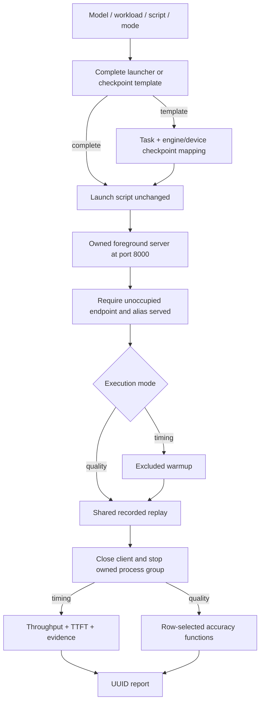

# Phase 3 review packet

## Status and scope

Phase 2 is committed as `32ba1da` (`feat: prepare native Harbor evaluation tasks`).
Phase 3 is committed as `efd36509896d17f80621426e6526bb8fe4ef2273`
(`feat: launch servers and replay recorded workloads`). It supplies launch,
server ownership, streaming clients, recorded scheduling and measurement.

Phase 4 revises those APIs for complete verification: fixed port 8000, optional
checkpoint filling, configurable row concurrency and shared quality execution.
This packet describes the current runtime contract. The original Phase 3 commit
remains one approved commit; Phase 4 changes are uncommitted for review.
Production baseline scripts and Dockerfiles still await owner supply.

## Review order

| Order | File | Responsibility |
| --- | --- | --- |
| 1 | `eval/launch.py`, `tests/test_launch.py` | Detect an unfilled checkpoint input, preserve completed scripts and validate protected tuning. |
| 2 | `eval/baselines.py`, `tables/baseline_map.csv` | Resolve engine/device/checkpoint from baseline paths or selected reference context. |
| 3 | `eval/bench/serve.py`, `tests/test_serve.py` | Own startup checks, logs and process cleanup, or attach diagnostically. |
| 4 | `eval/request_policy.py`, `tables/request_fields.json`, `eval/bench/clients.py` | Preserve authored requests and consume streams with timing/quality-appropriate checks. |
| 5 | `eval/bench/replay.py`, `tests/test_replay.py` | Admit rows with default/explicit concurrency and preserve parent/delay ordering. |
| 6 | `eval/bench/metrics.py`, `eval/bench/run.py`, `tests/test_bench_run.py` | Load the correct data view and compose timing/quality execution into a UUID report. |
| 7 | `eval/tasks.py`, `templates/`, `images/README.md` | Align the role data, fixed endpoint and complete/template launcher contract. |

ChatClient connects directly to the endpoint. Server manages its process rather
than introducing another transport connector. The CLI lives beside execution;
there is no separate cli.py, Template class, header schema or generated script.
Accuracy modules and the verifier are covered in [Phase 4](phase-04.md).

## Launch and execution

Every owned server must advertise `served` at `http://127.0.0.1:8000` and remain
in the foreground. A completed candidate launcher includes its final weights,
installed environment and optimized settings and executes unchanged.
An unfilled `$CHECKPOINT`/`${CHECKPOINT:?…}` input indicates a baseline template.
Only then is the selected mapping injected; no PORT is supplied. Filled local
assignments and nonempty checkpoint defaults count as complete.

Baseline folders identify device/engine. A copied template uses the selected
model/workload's public reference.json; private verification passes its protected
reference/task context. Different C2 engines use different mapped weights:
FreeToken's HF checkpoint and Ollama's native tag are preserved. Source-equal
mappings reuse /models/source. Complete candidates get no source-weight fallback.

External tuning remains args/env. Canonical model/host/port/served-name flags and
CHECKPOINT, PORT, BASH_ENV and ENV cannot be overridden. Trusted backend callers
may extend protected aliases/names. /bin/bash remains absolute. The runner does
not rewrite scripts or reinterpret their optimized parameters.



Startup fails for wrong port/alias, a preoccupied endpoint, early exit or timeout.
Owned groups stop on success, failure and cancellation; attached servers remain
running. Servers inherit their caller's OS identity. Fresh verification starts
both reference and candidate as root with clean environments; its runner owns
the offline serving interval and restores egress after owned process cleanup.
Server has no user-switching or access-control interface.

## Requests, modes and concurrency

Replay preserves original messages/tools and prior recorded answers. Requests
wait for every parent and applicable tool delay. Results retain dataset order;
protocol failure keeps row/request context and cancels unfinished siblings.

| Workload | Default active rows | Tool delays |
| --- | --- | --- |
| S-1 | One | Not applicable |
| S-N | All | Not applicable |
| A-1 | One | Skipped |
| A-N | Eight | Preserved |
| A-MA | One; branches may overlap | Preserved |

A positive --concurrency overrides active rows; -1 admits all independent rows.
Dependencies and applicable delays remain intact. Quality defaults to -1 and
uses S policy/data even for A/MA tasks. Timing sends one excluded warmup and
requires stream/count/timing evidence. Quality has no warmup or performance
metrics and requires complete responses without token usage accounting.

## Actual usage and checks

The automatic CLI regression exports two supplied public C2 S rows and creates
a test-only launcher in an Ollama baseline folder. Its parameter JSON supplies
`--workers 2` and TEST_PARALLEL=2 to the scripted HTTP peer:

```bash
python -m eval.bench.run C2 S-1 \
  <test-workspace>/images/nvidia-cuda-x86/baselines/ollama/launch.sh \
  --params <test-workspace>/params.json
```

It checks mapped native checkpoint, port 8000/alias served, original requests,
one excluded warmup, two measured requests, six scripted output tokens,
UUID report metadata and the stopped server. It also executes quality mode with
an A-N task against S data for both the template and a completed optimized
candidate. The fixture deliberately answers incorrectly; reports contain only
accuracy 0.0. These are CPU integration results, not real Ollama/GPU performance.

```bash
uv run pytest -q tests/test_launch.py tests/test_serve.py tests/test_clients.py tests/test_replay.py tests/test_bench_run.py
uv run pytest -q
uv run ruff check .
uv run ruff format --check .
uv build
```

Tests retain two common and two edge functions per area and reuse the existing
local HTTP/SSE fixture. Public-recording API integration covers all five
workloads; concurrency tests use barriers rather than speed assertions.
[Phase 4](phase-04.md) adds dedicated accuracy, native Rewardkit review, paired
quality gating and final verification. Native Harbor owns adapter coordination
and reference finalization in Phase 4. Phase 5 accepts supplied device/engine
assets; Phase 6 validates measured search/coding and complete evaluation on hardware.
