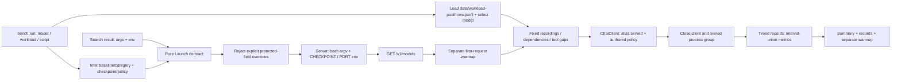

# Phase 3 review packet

## Status and scope

Phase 2 is committed as `32ba1da` (`feat: prepare native Harbor evaluation tasks`).
Phase 3 is **approved for its single phase commit**. It adds the shared
measurement engine: resolve a baseline launcher/model, start and test its server,
warm up, replay recorded requests, check streamed responses and compute timing.

The launch contract is defined first in `eval/launch.py`. This pure class does
not read templates or depend on a particular engine. Production baseline scripts
will be supplied in later phases to implement it. Each supplied `launch.sh` lives
beside `install.sh`; both are required and hashed by image selection. Harbor owns
the single task image/container. Candidate `/workspace/launch.sh` implements the
same interface; no production script or Dockerfile is invented now.

## Review order

| Order | File | What it does and why it is separate |
| --- | --- | --- |
| 1 | `eval/launch.py`, `tests/test_launch.py` | Define a pure execution contract: fixed suite inputs, external args/env and explicit protected fields. Tests work before any backend script exists. |
| 2 | `eval/baselines.py`, `tables/baseline_map.csv`, `images/README.md` | Select the baseline checkpoint and fixed script path; describe the interface that later supplied scripts must implement. No launch catalog or template parser. |
| 3 | `eval/bench/serve.py`, `tests/test_serve.py` | Prepare Launch before spawning, own readiness/logs/process cleanup, or attach without ownership. |
| 4 | `eval/request_policy.py`, `tables/request_fields.json`, `eval/bench/clients.py` | Build authored requests and consume SSE into output/count/timing evidence. Serving uses fixed alias `served`. |
| 5 | `eval/bench/replay.py` | Schedule fixed recordings, session concurrency, dependencies and workload tool delays. It owns neither HTTP nor startup. |
| 6 | `eval/bench/metrics.py`, `eval/bench/run.py`, `tests/test_bench_run.py` | Infer baseline/checkpoint/policy from the script path, load the workload pool automatically, allocate a port and save UUID results; compose Server → warmup → replay → cleanup → metrics/report. |
| 7 | `eval/tasks.py`, `.dockerignore`, `templates/run.md`, `templates/search.md` | Include supplied launch assets in the image identity/context and communicate parameter handoff using the stable contract. |
| 8 | Remaining Phase 3 tests, `tests/http_server.py`, `pyproject.toml`, `uv.lock` | Validate actual HTTP/SSE scheduling and package the minimal runtime. Two common and two edge functions per area. |

The five new production modules own launch composition, process lifecycle, HTTP
evidence, scheduling and measurement. There is no separate Template class,
script-header parsing/cache, shell renderer, launch metadata table or generator.
The CLI remains beside measure(), avoiding another cli.py. ChatClient connects
directly to the serving endpoint; Server only manages its process.

## Launch contract and execution

Launch contains a script path, checkpoint, port, external args/env, and explicit
`fixed_options`/`fixed_env` sets. `prepare()` rejects conflicts and returns:

| Input | How it reaches the process |
| --- | --- |
| Suite checkpoint | Environment variable `CHECKPOINT` |
| Suite port | Environment variable `PORT` |
| Fixed served model/host | Later script exposes `served` on `127.0.0.1` |
| Tunable server options | Separate argv entries after the script |
| Tunable environment | Other process environment entries |

Default protected flags are `--model`, `--host`, `--port` and
`--served-model-name`. An external `--model` or `--model=other` fails.
`CHECKPOINT`/`PORT` cannot appear in external env. Trusted callers may extend the
protected sets with backend aliases and owned environment names when integrating
supplied scripts; parameter JSON supplies only args/env. Validation runs again
immediately before starting, so changed dictionaries cannot reuse an old result.
No script file is needed to compose or validate a launch.

Script defaults remain script-owned. Search saves a parameter file, changes its
args/env for another trial and reuses the same protected baseline script. The
suite continues choosing the checkpoint and port. Production device integration
will connect engine-specific flags/env and scripts to this interface in Phase 6.
Headers such as `# fixed:` or `# fixed-env:` are not required or parsed.



Source-equal mappings use `/models/source`; distinct mappings retain their model
identifier, such as C2 Ollama's `qwen3.6:35b-a3b-mtp-q4_K_M`. Candidate scripts
receive the source mount and may create quantized/derived workspace outputs.
The CLI takes MODEL WORKLOAD LAUNCH_SCRIPT. `--params JSON_FILE` is the only
optional tuning input; omitted params use backend defaults. It infers engine and
category from the supplied baseline path, loads data/<pool>/rows.jsonl using the
workload, selects the model, allocates a free local port and creates bench/<uuid>
for its server log/report. Other script paths use candidate policy and source
weights. Diagnostic attachment is API-only; CLI runs always launch and stop.
[README](../README.md#measure-prepared-recordings) lists every CLI option/default.

An owned process group receives TERM then KILL before returning metrics/report,
including on failure or cancellation. Attached servers stay alive. API callers
can set cwd/log/user; HOME or other external env belongs in Launch.env unless
protected. Switching user alone does not change HOME or cwd.

## Request and replay behaviour

The client parses the supplied `messages` and nullable `tools` JSON strings when
building HTTP. Setup and replay keep dataset values unchanged. SSE is framed by
blank lines independently of packet boundaries. Content/reasoning/tool deltas
start TTFT; role-only events do not. The finish marker includes invisible forced
generation in the final boundary, and server usage supplies the actual count.
Streams require output, finish, usage and `[DONE]`; a total deadline also stops
endless heartbeats. No tokenizer or answer grading is used.

| Workload | Sessions | Within each row |
| --- | --- | --- |
| `S-1` | One at a time | The recorded single request; output may stop early |
| `S-N` | All selected rows | The recorded single request; output may stop early |
| `A-1` | One at a time | All-parent ordering; tool delays skipped; exact recorded count |
| `A-N` | At most eight in flight | All-parent ordering; tool delays preserved; exact recorded count |
| `A-MA` | One at a time | Independent branches overlap; all-parent joins and tool delays preserved; exact recorded count |

Recorded prior answers remain in later messages. Generated responses are evidence
only. Invalid protocol evidence raises ReplayError with row/request context;
HTTP/JSON/process/timeout failures propagate. Task groups cancel unfinished
siblings; failed replay returns no successful partial report.

## Executed usage and validation

The automatic-launch regression exports two supplied public C2 S rows into
data/S/rows.jsonl under a temporary workspace and constructs a test-only
Ollama-folder script and this parameter file:

```json
{"args": ["--workers", "2"], "env": {"TEST_PARALLEL": "2"}}
```

These are options for the scripted HTTP peer, not verified Ollama flags. It runs
the actual CLI from that workspace with three positional inputs and optional tuning:

```bash
python -m eval.bench.run C2 S-1 \
  <test-workspace>/images/nvidia-cuda-x86/baselines/ollama/launch.sh \
  --params <test-workspace>/params.json
```

Assertions confirm mapped checkpoint/port, fixed alias/host, forwarded tunable
args/env, automatic pool/model loading, internally chosen port, unchanged
recorded bodies and policy, one excluded warmup, two timed requests, six scripted
output tokens, a UUID result folder/launch metadata and the owned PID gone after
completion.
Reproduce it with:

```bash
uv run pytest -q tests/test_bench_run.py::test_cli_launches_mapped_baseline_and_reports_public_rows
```

Launch's two common cases compose execution even without script files. Its two
edge cases reject fixed option/env overrides; the former also proves no process
or log is created. Trusted backend-owned env protection is tested explicitly.
The public-row HTTP integration exercises all five workloads. Long tool gaps use
controlled idle there; scheduling tests independently check delay/concurrency
semantics and a recorded fork/join graph. This is CPU integration with scripted
output/counts, not model performance.

There are **60 tests**: the existing 56 plus four Launch tests. Each area retains
two common and two edge functions; no future shared infrastructure is added.
Runtime dependencies remain HTTPX and PyYAML. Harbor/HF/datasets/Jinja belong to
the host extra. Builds and a noneditable isolated runtime installation are checked.

```bash
uv run pytest -q
uv run ruff check .
uv run ruff format --check .
uv build
```

The quality/static gate and timed verifier are Phase 4; Harbor adapter
coordination/search are Phase 5. Source images/scripts and accelerator/model
acceptance remain owner-supplied Phase 6 inputs. Search billing stays outside
implementation cost accounting. Each evaluator phase is committed only after review.
