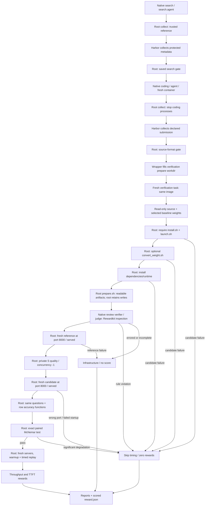

# Phase 4 review packet

## Status and scope

Phase 3 is committed as `efd36509896d17f80621426e6526bb8fe4ef2273`
(`feat: launch servers and replay recorded workloads`). Phase 4 implements the
complete verification path given supplied dataset columns and authored device assets
and is approved for its single phase commit. Each approved phase becomes one commit.

It aligns earlier launch/replay/task interfaces with verification: fixed endpoint,
optional mapped weights, shared timing/quality executor, concurrency controls,
dataset-selected Python accuracy and native Harbor Rewardkit agent review.
There is no dataset audit, tokenizer, duplicate quality scheduler, generated
image or duplicate task runtime. Search, coding and verification are three
native Harbor jobs, each using a separate container from the same category image. Verification's prepare/review/measure verifiers share its container, using
native TOML users root/judge/root and a native no-op trial agent. Harbor owns agent
coordination, and trusted reference finalization is implemented here. Phase 5 accepts supplied device assets and offline weight availability;
Phase 6 validates real agents, measured reference tuning and full quality/timing.

## Review order

| Order | Files | What they do and why they are needed |
| --- | --- | --- |
| 1 | [launch.py](../eval/launch.py), [serve.py](../eval/bench/serve.py) | Run completed launchers unchanged or fill an unassigned CHECKPOINT; require foreground ownership, port 8000/alias served and cleanup. |
| 2 | [baselines.py](../eval/baselines.py), [baseline_map.csv](../tables/baseline_map.csv) | Select engine/device weights for the model/workload task; copied templates use the chosen reference while complete candidates need no mapping. |
| 3 | [clients.py](../eval/bench/clients.py), [replay.py](../eval/bench/replay.py) | Collect mode-appropriate responses and schedule independent rows with default/positive/-1 concurrency, preserving parents and tool delays. |
| 4 | [bench/run.py](../eval/bench/run.py) | Share one executor between timing and accuracy; load S in quality mode and keep public accuracy summaries separate from performance. |
| 5 | [accuracy/__init__.py](../eval/accuracy/__init__.py), [math_verify.py](../eval/accuracy/math_verify.py), [letter.py](../eval/accuracy/letter.py) | Load the trusted function named by evaluation.method; checker modules own extraction and mathematical dependencies. |
| 6 | [judge.py](../eval/verify/judge.py), [rules.toml](../eval/verify/rules.toml), [prompt.txt](../eval/verify/prompt.txt) | Four judging behaviours: submission format, native rubric/prompt, reviewer decisions and paired quality. No access, process, authentication or network control. |
| 7 | [verify/run.py](../eval/verify/run.py) | Implement handoff, root preparation, native judge review and root measurement; resolve launches, own deadlines/processes and write step reports/rewards. |
| 8 | [prepare.sh](../images/prepare.sh), [images/README.md](../images/README.md) | Root prepares artifact ownership and writable judge directories. Harbor changes step users from TOML; the image script launches no reviewer and switches no user. |
| 9 | [tasks.py](../eval/tasks.py), [task.toml.j2](../templates/task.toml.j2), [docker-compose.yaml.j2](../templates/docker-compose.yaml.j2), [verification.toml.j2](../templates/verification.toml.j2), [verification-compose.yaml.j2](../templates/verification-compose.yaml.j2), [verification-test.sh](../templates/verification-test.sh), [coding.md](../templates/coding.md), [run.md](../templates/run.md), [oracle-search.sh](../templates/oracle-search.sh), [oracle-coding.sh](../templates/oracle-coding.sh) | Generate all three native tasks, shared root/judge/root verification, source-only handoff and read-only trusted mounts. Generate native oracle solutions at search/coding solution/solve.sh. |
| 10 | [search/run.py](../eval/search/run.py), [test_search.py](../tests/test_search.py) | Validate mapped selection/params in a root native collection hook; the later verifier reads its saved gate result. No weights or search runtime are copied. |
| 11 | [config.py](../eval/config.py), [setup.py](../eval/setup.py), [run.py](../eval/run.py), [pyproject.toml](../pyproject.toml) | Map reviewer selection and native credential names; wire oracle selection, public S views, image identity and packaged runtime into preceding phases. |
| 12 | [test_launch.py](../tests/test_launch.py), [test_serve.py](../tests/test_serve.py), [test_bench_run.py](../tests/test_bench_run.py), [test_accuracy.py](../tests/test_accuracy.py), [test_quality.py](../tests/test_quality.py), [test_judge.py](../tests/test_judge.py), [test_verify.py](../tests/test_verify.py), [test_oracle.py](../tests/test_oracle.py) | Two common and two edge functions per area. CPU process/HTTP tests reuse supplied public recordings; opt-in native Harbor cases use the existing production image and actual Claude Code. |

## Verification procedure



The coding task declares `/workspace/submission` as its only artifact. A root
collection hook stops the coding-owned processes and clears the
children of Harbor's implicit `/logs/artifacts` directory, preserving the mounted
directory itself. Harbor collects the declared source; the wrapper copies it into
`verification/<task-id>/steps/prepare/workdir/submission`. Harbor starts the verification
task and uploads that workdir into `/workspace`, restoring only the submission. Coding homes,
installed dependencies, background servers, candidate weights and caches do not
migrate.

The fresh verifier has read-only `/models/source` and `/models/reference` mounts.
The latter contains only the baseline weights selected during search. Its
protected metadata is at `/root/eval/reference/reference.json`; `task.reference`
names that path. The reference launcher and installed engine come from the same
category image, not the search container's filesystem.

The submission contains code, `install.sh`, `launch.sh` and optional
`convert_weight.sh`. Preparation runs as root with internet and a clean
environment: `CHECKPOINT=/models/source`, `WEIGHTS=/workspace/weights` and
`RUNTIME=/workspace/runtime`. Conversion runs before installation, so its
prerequisites must exist in the category image or be acquired by conversion.
The two scripts use the configured installation deadline individually. A failure
stops before judge review or any server starts. No separate checkpoint generator
is required: the optional submitted conversion script is the reproducible source.

Launch resolution occurs after conversion and installation: conversion creates
derived weights, while installation reproduces dependencies and may complete the
final launch script. A complete launcher contains the
correct weights/environment/optimized parameters and is executed unchanged.
Unfilled CHECKPOINT input means a baseline template; the selected
model/workload and engine/device mapping supply weights. No PORT is injected,
no free port is chosen, and there is no mandatory candidate source-weight fallback.
Server rejects wrong port/alias, preoccupied endpoints, early exit and timeout
before replay. Candidate startup failures are scoreable zeros; reference startup
failures prevent a candidate verdict.

Quality uses the same saved private S sample of up to 24 rows for every workload.
Shared replay with concurrency -1 makes all rows eligible at once, allowing the
backend to batch. It sends no warmup, records no timing/count metrics and requires
valid complete responses. Dedicated accuracy modules run after server cleanup;
each authored method identifies its checker. Internal results retain correctness
for every expected row; public quality reports only final accuracy.

The exact paired test compares reference/candidate correctness, not aggregate
accuracy alone. Five losses and no wins among 20 pairs yields p=1/32 and fails;
four yields p=1/16 and passes. An invalid candidate stream fails separately from
answer correctness. Dropped or extra row IDs cannot disappear from the comparison.
A passed gate starts new timed servers with independent excluded warmups.

## Native rules review and role boundaries

`harbor-rewardkit` 0.2.1 provides the agent judge. Its rubric reviews six binary
criteria together and aggregates all-pass. Choose claude-code, codex or fx through
`evaluation.agent.name`, optionally set `model`, and select `auth`, `env`, `budget`
and native Rewardkit `kwargs` (`version`/`mcp_servers`). This reviewer is independent
of search/coding adapters; no bespoke Claude CLI/schema/tool wrapper remains.
[Rewardkit quickstart](https://docs.harborframework.com/core-concepts/rewardkit/quick-start),
[judge criteria](https://docs.harborframework.com/core-concepts/rewardkit/judge-criteria).

Wrapper fields map to Harbor's native agent/task configs and Rewardkit's native
`JudgeConfig`; see the [mapping reference](reference.md#mapping-to-harbor-and-rewardkit).
Harbor selects the OS identity for each entire verifier. The coding
verifier is shared root and checks the source-format handoff. The third task
starts a fresh container and uses native `nop`, with these verifiers:

| Step | Native `steps.verifier.user` | Behaviour |
| --- | --- | --- |
| `prepare` | `root` | Format, optional conversion, installation and artifact permissions. |
| `review` | `judge` | Native Rewardkit inspection of the prepared system. |
| `measure` | `root` | Paired S quality, fresh timing, scoring and reporting. |

All three declare `environment_mode = "shared"` within the new task. Prepare
and review gate later steps with `min_reward = 1`. Reviewer evidence is exported as flat files
under `/logs/verifier`; Harbor can archive these files across container and host
user IDs without transferring the private reviewer directory. Harbor changes users directly;
no `setpriv` or user-switching launcher remains. The wrapper publishes the last
verification step's rewards rather than search or handoff gate rewards.

The image defines a judge user with a private writable home/cache. Root invokes
`images/prepare.sh` after installation to set completed submission/runtime/weights
root-owned and readable, without judge write access. It prepares writable
`/home/judge/tmp`, `/home/judge/.cache` and `/workspace/review-output`. Root retains
write access. Private data beneath `/root/eval` remains inaccessible to judge;
source/reference read-only mounts are unchanged. Verification Compose declares
`no-new-privileges:true`; root stays root and judge cannot elevate through setuid
execution. Rewardkit overlay isolation is disabled and no custom Claude tool
policy or settings file is generated.

`judge.py` has exactly four functions:

| Function | Behaviour |
| --- | --- |
| `static_check()` | Check required install/launch scripts and the optional conversion script. |
| `write_review()` | Build the native Rewardkit rubric and inspection prompt from the protected task and reviewer config. |
| `rules_result()` | Interpret six binary decisions, separating violations from unusable evidence. |
| `paired()` | Compare complete per-row quality results with the exact paired test. |

It contains no user switching, permission changes, process launches,
authentication handling or firewall operations. The runner owns `Backend`,
quality probing and each stage's execution. Root prepare reads protected metadata,
writes its result to `/root/eval/verification/prepare.json` and creates readable
review inputs under `/workspace/review-rubric`. It invokes only the image's root
permission script:

```text
/bin/bash /opt/eval/images/prepare.sh SUBMISSION RUBRIC_DIR OUTPUT_DIR
```

Harbor then executes the review stage as judge. That stage reads the prepared
rubric rather than `/root/eval/task.json` and invokes Rewardkit directly:

```text
/opt/eval/.venv/bin/python -I -m rewardkit /workspace/review-rubric \
  --workspace /workspace/submission --output /workspace/review-output/reward.json
```

Rewardkit reads backend/model/timeout from its native rubric and owns agent
execution and authentication. Criteria stay in `rules.toml`; inspection context
stays in `prompt.txt`. No provider-specific login bridge is added.

For login, provide `CLAUDE_CODE_OAUTH_TOKEN`, `CODEX_AUTH_JSON` or
`VERCEL_OIDC_TOKEN` on the host for Claude, Codex or Fx respectively. Claude's
`claude setup-token` can supply its token; Codex consumes authentication JSON
through its native environment input. The wrapper does not read or mount host
login files. A logged-in host CLI alone is insufficient for verification;
search/coding retain the selected Harbor adapters' authentication behavior.
API-key mode defaults to `ANTHROPIC_API_KEY`, `OPENAI_API_KEY` or
`AI_GATEWAY_API_KEY`; explicit `env` names replace defaults through the review
step's `[steps.verifier.env]`. Prepare and measure receive no reviewer credentials. For Codex, `env: [CODEX_AUTH_JSON,
REWARDKIT_FORCE_SUBSCRIPTION]` also forwards that optional native subscription flag
when provided. Values never enter saved run YAML, task.json or image layers.
Native oracle submissions use the same reviewer and authentication.

Rewardkit raw results persist under `/workspace/review-output`. Review copies
them, plus prompt/rubric/log evidence, to its native `/logs/verifier` directory.
Harbor archives and resets that directory between steps; root measure reads the
persistent prepare and review results. All six decisions must be usable. Actual rule violations
fail the candidate; provider timeout, missing/malformed decisions or errors give
no score. The evaluator owns final performance reward.json independently.

Conversion and installation are online root processes; the reviewer also runs
online. After review, the root runner applies IPv4/IPv6 loopback-only controls
for quality/timing. Cleanup ends owned process groups before removing those
controls, including on failure/cancellation. Root processes are never terminated
by UID. The shared Server inherits its caller's identity and has no user-switching
or access guard interface.

## Public replay and setup alignment

Timing loads data/<task-pool>/rows.jsonl. Quality always loads public data/S, so
setup now loads and mounts S-public even for A-only/A-MA-only runs. Existing
private S calibration/quality samples remain separate and trusted.
Positive concurrency limits independent rows/sessions; -1 admits all ready rows
while respecting within-row parents and applicable tool delays.

A baseline path identifies engine/category. For copied templates, the trusted
reference finalizer publishes category, baseline, checkpoint and parameters
before native search artifact collection. The wrapper copies that selection and
binds its public mirror at /workspace/reference.json in coding. Completed
candidates run without that file or any candidate-weight mapping.

## Actual usage and validation

The live source-review fixture's native search solution writes this actual
selection (it does not claim an inference measurement):

```json
{"baseline": "freetoken", "args": [], "env": {}}
```

The generated root collection hook runs
`eval.search.run --task /root/eval/task.json --stage collect` before Harbor
collects the reference artifact. It resolves the checkpoint from the protected
model/device mapping and rejects overrides of fixed launch inputs. The ordinary
root test calls `--stage gate` to report the saved decision. The wrapper then
copies only reference/public metadata and selects the trusted host-weight bind.
Production oracle search instead writes this shape from its real calibration
benchmark report.

The generated coding hook performs only handoff:

```bash
/opt/eval/.venv/bin/python -I -m eval.verify.run --stage handoff --task /root/eval/task.json
```

The verification task's generated hooks select prepare, review and measure:

```bash
/opt/eval/.venv/bin/python -I -m eval.verify.run --stage prepare --task /root/eval/task.json
/opt/eval/.venv/bin/python -I -m eval.verify.run --stage review
/opt/eval/.venv/bin/python -I -m eval.verify.run --stage measure --task /root/eval/task.json
```

Only root stages load protected metadata. Review reads its prepared rubric, with
judge HOME/cache and native credentials supplied by the review step TOML. The
hidden `--collect-submission` hook stops coding-owned leftovers and clears
implicit artifacts; it performs no evaluation. The wrapper coordinates
`jobs/search`, `jobs/coding` and `jobs/verify` and writes the final per-task `result.json`.

### Native Harbor oracle

Select `agent.name: oracle` in run configuration. The wrapper passes Harbor's
built-in OracleAgent without a coding model override. The generated search and coding
tasks each supply native `solution/solve.sh`. The search solution provides a valid known
reference selection by measuring the model's first mapped baseline on calibration
S-N and saving `selection.json`; the ordinary root reference finalizer consumes
that evidence through a root native collection hook before artifact collection.
The ordinary test reports its protected decision. The coding solution reads the
public reference mirror and writes an ordinary baseline-backed submission with
install/launch scripts and provenance. Its open CHECKPOINT input selects the
protected reference's actual mounted weights and authored request policy.

An oracle is a supplied implementation, not supplied model answers. Harbor
executes the solution scripts, then the usual step verifiers. Its coding output
is transferred to a fresh container and goes through every gate, including
conversion when supplied, installation, judge review, quality and timing. The
baseline-backed install script may reuse image-installed baseline software. There
is no local `eval.verify.oracle` module, `--oracle` verifier flag or trusted-control
bypass. Comparing against the same baseline is a full-pipeline sanity check;
quality should be comparable, while repeated timings can vary.

Executed CPU regressions exercise these behaviours:

- Launch/server tests run real processes, preserve complete optimized weights,
  supply mapped templates, require port/alias and terminate owned descendants.
- The public CLI runs a mapped C2 Ollama template at port 8000 with two supplied
  S rows. It checks native checkpoint, unchanged requests, warmup and timing;
  quality mode also runs with A-N but reads S and writes accuracy alone.
- Quality tests with the same public S view require every request to arrive
  before responses and omit token usage. Correct scripted answers yield accuracy
  1 with no warmup or timing fields.
- Accuracy tests accept boxed 16/final C and reject wrong, incidental or
  ambiguous answers through row-selected functions.
- Rules integration checks the actual Rewardkit interface with a substituted
  paid judge backend, including violations and infrastructure failures.
- Verifier HTTP tests use synthetic letter answers, fresh stage contexts and
  rewards derived only from measured records. They assert conversion, installation,
  artifact protection and review occur before quality. Preparation/protocol failures
  skip or invalidate timing; reference failure removes stale rewards.

The reward fixture compares throughput 10→20 and TTFT 2→1; each reward is 50.
No noisy CPU fixture is required to exhibit that speedup. These CPU evaluator
fixtures are not production model performance results.

```bash
uv run pytest -q tests/test_launch.py tests/test_serve.py tests/test_bench_run.py tests/test_accuracy.py tests/test_quality.py tests/test_judge.py tests/test_verify.py tests/test_oracle.py
uv run pytest -q
uv run ruff check .
uv run ruff format --check .
uv build
```

The runtime regressions cover the actual Rewardkit interface, with paid model
responses substituted explicitly. Role/firewall command doubles in unit tests do
not modify the host firewall or establish container isolation.

Opt-in native Harbor reviewer acceptance is separate:

```bash
LOCAL_EVAL_HARBOR_TESTS=1 uv run pytest -q -s tests/test_oracle.py
```

The suite reuses an existing production device image, Harbor's native OracleAgent
and actual Claude Code with native credentials. It builds no test image and substitutes
no reviewer executable. The generated search/coding tasks use separate containers;
the wrapper transfers the submission into a new task using native nop. Its shared
root/judge/root steps exercise static checks, optional conversion, preparation,
image-provided artifact permissions and real Rewardkit review. The trusted final
test hook writes acceptance rather than a model-performance reward. Actual
FreeToken source is mounted read-only at its authored commit; its full engine
dependencies are not installed. The test hook reports that distinction explicitly.

This is reviewer integration acceptance. Quality replay and timing remain covered
by their bounded unit/process tests; full GPU/model acceptance needs real weight
shards and a working engine install. The available model directories contain
configs/tokenizers only. The legacy baseline launcher also requires PORT; the suite
does not inject it, so production launchers must fix port 8000 themselves. The
completed-launcher test supplies that fixed port explicitly. Source-review approval
alone does not prove startup or inference. Search
selection uses an explicit test-only oracle input without inference; the actual
trusted finalizer and native metadata handoff are exercised.

Earlier revision-22 acceptance used a toy CPU image and synthetic Claude executable.
That historical run established lifecycle behavior only; it did not test Claude
login, permissions or source-review quality. Later acceptance used the real
reviewer and a production image.

## Current three-job validation

The current default suite passes **80 tests**, with four opt-in live cases
skipped, in **14.91s**. Ruff lint/formatting, source/wheel builds and native
Harbor task/config validation pass. Each area retains four test functions.

All four live source-review behaviours were validated with native Harbor and
actual logged-in Claude Code in the existing production image:

| Case | Search/coding | Fresh verification result |
| --- | --- | --- |
| Baseline template | Native oracle, separate containers | Prepare/root, real review/judge and final root probe pass. |
| Completed candidate launcher | Native oracle, separate containers | Conversion/install, real review and final root probe pass on targeted retry. |
| Conversion exits 23 | Native oracle, separate containers | Prepare gate returns zero; install/review/measure do not run. |
| Answer lookup | Native oracle, separate containers | Real reviewer rejects generated_answers; measure does not run. |

The initial batch was **3 passed, 1 failed in 2932.79s**. The completed-launcher
review finished its tools but returned no decision within its 900s test budget.
It correctly produced an infrastructure error and no reward, not a candidate
rejection. That attempt remains in the evidence. A targeted retry using the
existing production default of 1800s passed in **242.46s** with unchanged image,
reviewer and rules. The accepted case set contains twelve native trials; fifteen
trials were observed including the earlier timeout. Cumulative test time was
3175.25s. This is not a claim that the original four-case batch passed unchanged.

The tests prove three distinct containers per task, protected root search
finalization before native artifact collection, selected read-only weight binds,
source-only coding handoff, native root/judge/root identities, private-data denial,
real reviewer tools and preserved root write access. The final measurement hook
is an explicit access/state probe. No model inference, answer quality or serving
performance result is claimed.

The live containers use immutable runtime snapshots. Later fixes in `run.py`
keep interrupted copies outside uploaded workdirs and restore Codex's redacted
mode controls from frozen config. Search collection clears stale reference output
and treats a missing protected launcher as infrastructure failure. The current
unit suite covers these edges; the live Oracle cases do not exercise Codex
authentication or those failure branches. Sanitized evidence records each
snapshot/current hash difference rather than claiming complete live coverage of
the final source.

### Historical revision-27 two-job acceptance

The default suite passed **76 tests**, with four opt-in live cases skipped, in
**15.18s**. Every test area retains four cases. Lint, formatting of 59 Python
files, wheel/source builds and diff checks pass.

All **four real Harbor/Claude cases passed in 931.50s**, covering eight native
trials, from immutable inputs at `/tmp/local-eval-harbor-live-xmbe4dvp`:

| Case | Original task | Fresh verification steps | Outcome |
| --- | --- | --- | --- |
| Baseline template submission | Native oracle search/coding | prepare → review → measure probe | Accepted. |
| Completed checkpoint launcher | Native oracle search/coding | prepare → review → measure probe | Accepted. |
| Conversion exits 23 | Native oracle search/coding | prepare only | Rejected before installation or review. |
| Precomputed answer lookup | Native oracle search/coding | prepare → review | Real Claude rejected the lookup; measure skipped. |

Actual process/file probes confirmed UID 0 preparation, UID 1002 Rewardkit/Claude,
UID 0 later measurement probe, one shared fresh verification container, private
data denial, read-only candidate access for judge and root artifact writes.
A production-image probe also reproduced cross-user nested-log archival failure;
flat verifier evidence files archive successfully while the reviewer workspace
remains private.

The initial native manifest path and evidence archive failures were fixed and
rerun from a new immutable snapshot. This final batch tests source review and
verification lifecycle. Its final step is explicitly an access/state probe;
checkpoint shards and complete engine dependencies are unavailable, so it does
not claim model inference, answer accuracy, quality or performance acceptance.
Phase 4 remains uncommitted for review.

### Historical revision-26 acceptance

The previous root-controller/image-launcher design passed **76 default tests**,
with four live cases skipped, in **22.07s**, plus lint, formatting and package
builds. All four real Harbor source-review cases passed in **1723.36s** using an
immutable evaluator snapshot, the production device image and actual Claude Code.
The authoritative batch was `/tmp/local-eval-harbor-live-qkdmuz8d`.

The native oracle and completed-launcher cases passed its root-preparation and
restricted-reviewer probes; conversion failure stopped before installation/review,
and saved-answer lookup was rejected. Those results establish the earlier
image-launched reviewer design, not the new native stepped identities. They do
not prove model inference, quality replay or performance. Earlier revision-25
native-credential and revision-22 synthetic-image results are also historical.
Phase 4 remains uncommitted for review.
