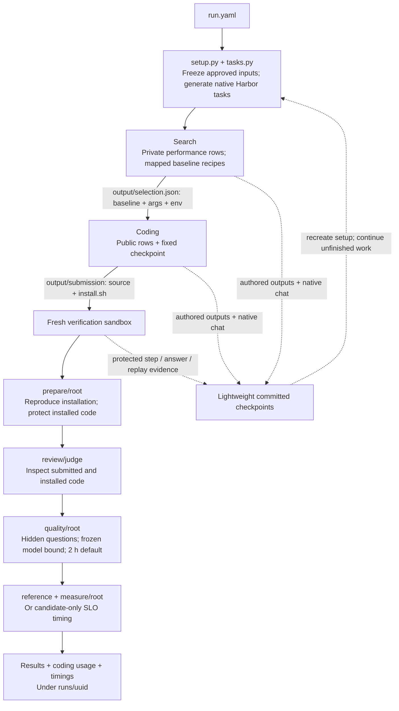

# Execution, isolation and recovery



Docker uses the local daemon and configured GPU IDs. Daytona uses provider
resources and spot GPUs. Harbor builds the task's device/phase Dockerfile at the
selected provider. Trusted `setup.sh` runs after container creation. The same
folder, permission, handoff and checkpoint contract applies to both providers.
Weights are downloaded inside the sandbox; there is no persistent shared volume
or host-to-sandbox weight copy. Fixed candidate weights/tokenizer are acquired
under `/models/target` and `/models/tokenizer` and made read-only. A distinct
reference checkpoint lives under `/workspace/runtime/reference/weights`.

## Authored and generated files

| Path | Contents | Lifecycle |
| --- | --- | --- |
| `/workspace/output/submission` | Coding source, patches, `install.sh` | Saved during coding; only this tree is handed to verification |
| `/workspace/output/selection.json` | Search baseline and parameters, or unsupported verdict | Saved and validated by the trusted handoff |
| `/workspace/output/experiments` | Agent experiment scripts, settings and compact replay results | Saved within the phase; not handed to verification |
| `/workspace/output/review` | Reviewer notes and structured verdict | Writable by judge; saved as review evidence |
| `/workspace/runtime/search` | Baseline installations, weight downloads, caches/builds | Recreated |
| `/workspace/runtime/candidate` | Generated candidate dependencies and builds | Recreated by `install.sh` |
| `/workspace/runtime/reference` | Reference installation and distinct reference weights | Recreated only when reference measurement remains unfinished |
| `/workspace/runtime/judge` | Reviewer cache and temporary files | Recreated |
| `/workspace/server.launch` | Generated fixed candidate entrypoint | Recreated by `install.sh` |
| `/workspace/.harbor` | Native conversations and framework state | Only explicit conversation/evidence subpaths are saved |
| `/var/lib/local-eval/verification` | Protected replay/quality evidence and implementation identity | Saved; environment-specific installation/readiness markers are excluded |

Authored outputs must be lightweight. Submit source changes or reproducible
patches, not installed environments or model bytes. Source symlinks must remain
within the submission. Checkpoint collection rejects links leaving its declared
saved roots and never reads through symbolic-link ancestors.

During coding, installation runs from `/workspace/output/submission`. Verification
imports the contents of that directory into `/workspace` and runs:

```sh
cd /workspace
bash ./install.sh
/workspace/server.launch /models/target
```

The installer resolves source relative to itself and puts generated files under
`/workspace/runtime/candidate`. Top-level submission names `.harbor`, `runtime`
and `output` are reserved. Experiment results and conversation files are not
submission inputs. Task prompts describe authored/generated boundaries; recovery
is implemented by the coordinator and toolkit.

## Access

| Sandbox path | Coding agent | Verification installer | Candidate server | Reviewer |
| --- | --- | --- | --- | --- |
| Authored submission | Write under `output/submission` | Reproduce imported source | Read | Read |
| `runtime/candidate` installed code | Write | Write, then sealed | Read | Read |
| `runtime/candidate/cache` and `tmp` | Own write | Own write | Own write | No write |
| `runtime/reference` | Absent | Separate reference identity | No access | No access |
| `runtime/judge`, `output/review` | Absent | No write | No write | Own write |
| `/inputs/public`, `/inputs/reference.json` | Read | Not required | Not staged | Not staged |
| `/models/target`, `/models/tokenizer` | Read | Read | Read | Read |
| Private data, quality answers and trusted completion state | Absent | No access | No access | No access |
| `/opt/eval`, `/opt/python` | Read/execute | Read/execute | Cannot edit | Cannot edit |

Phase Dockerfiles create users and parent folders. Trusted setup applies modes to
uploaded inputs. `task.toml` selects the native step identities. Root controls
procedures; submitted installers/servers and the reviewer use separate nonroot
identities with no new privileges. Installed code is sealed while designated
cache/tmp directories remain writable. Required gate failure stops later Harbor
steps. Filesystem permissions, not Python row filters, enforce private-data access.

## Resume

A completed task needs no allocation. An interrupted task starts from its saved
configuration, with the same concurrency, retry limits and agent conversation.
A replacement must match the saved GPU/VRAM/PCIe, CPU group, cores, RAM and disk
fingerprint before downloading weights. New and retained local environments both
rerun setup; retained environments can reuse a valid fixed checkpoint already on
disk. Generated runtime directories are cleared and rebuilt. Authored outputs and
explicit native histories remain available. No whole homes, dependencies, model
weights or compiler caches are checkpointed.

| Interrupted work | Durable state | Next action |
| --- | --- | --- |
| Search/coding agent | Authored outputs and native session | Restore work and continue the native conversation |
| Reviewer | Native conversation plus submitted source on the host | Reproduce installation; continue review if unfinished |
| Public/private replay | Complete graphs/N batches and request journal | Keep completed units; restart the interrupted whole unit |
| Quality | Completed answers and grades, including incorrect ones | Keep answers; resend unfinished questions within the remaining budget |
| Installation/download | Source, recipes and acquisition settings | Rerun required preparation; old success markers do not establish a fresh installation |

A lightweight installation fingerprint binds saved review and quality approvals
to reproduced source and installed executable contents. A changed build archives
and invalidates affected candidate approvals and journals. Reference evidence is
independent. Successful installation/prepare markers are environment-local and
are not restored as proof that dependencies exist.

Capture runs every 15 seconds and once during ordinary cleanup. A manifest is
published only after all changed objects arrive. A failed transfer leaves the
previous committed state intact. A lost sandbox can lose work after the latest
successful capture; if no native conversation was ever captured, the coordinator
records that loss and starts the original task prompt as previously authorized.

Each replay uses one server and one short excluded warmup. A replacement server
warms once, skips completed units and restarts the unfinished unit. Server memory
and sockets are not restorable. Time budgets and completed evidence survive
interruption; pauses/setup are reported separately. Performance cutoffs are
terminal candidate results, while infrastructure failure uses the configured
retry/backoff policy. See [benchmark.md](benchmark.md) for cutoff and scoring rules.
